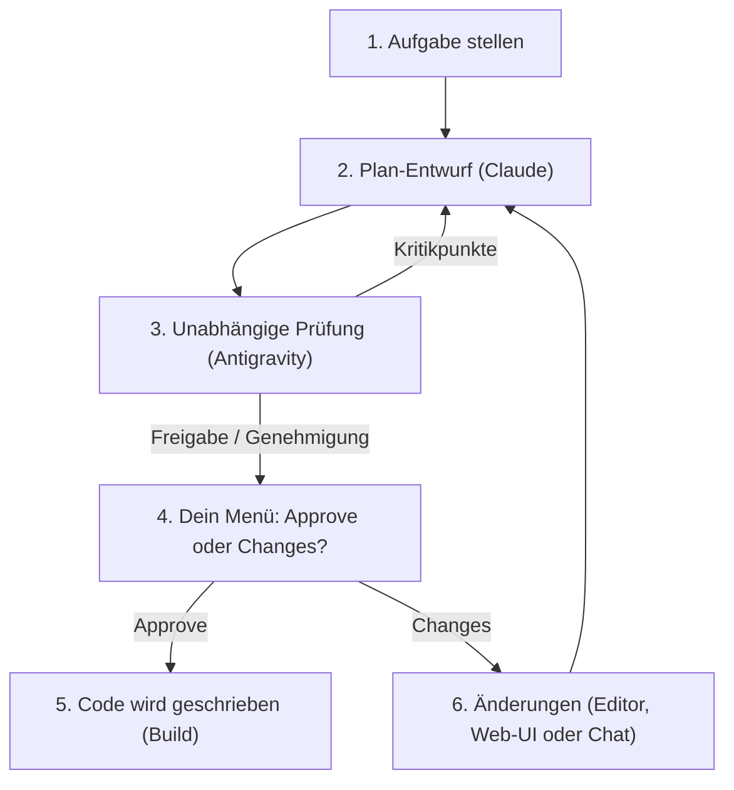

# ClaudeGravity Loop 🚀

> **Cross-Model Dual-Loop für Claude Code & Google Antigravity (`agy` / `gemini`).**  
> Verhindert KI-Betriebsblindheit durch ein unabhängiges 4-Augen-Prinzip: *Wer den Plan oder Code entwirft, darf ihn niemals selbst benoten.*

---

## 📑 Inhaltsverzeichnis / Table of Contents
* [🇩🇪 Deutsche Dokumentation (Für Einsteiger & Anfänger)](#-deutsche-dokumentation-für-einsteiger)
  * [1. Was ist ClaudeGravity Loop? (Einfach erklärt)](#1-was-ist-claudegravity-loop-einfach-erklärt)
  * [2. Voraussetzungen](#2-voraussetzungen)
  * [3. Die wichtigsten Befehle auf einen Blick](#3-die-wichtigsten-befehle-auf-einen-blick)
  * [4. Schritt-für-Schritt: Dein erster Durchlauf](#4-schritt-für-schritt-dein-erster-durchlauf)
  * [5. Das Menü: Plan freigeben oder ändern (Approve & Changes)](#5-das-menü-plan-freigeben-oder-ändern-approve--changes)
  * [6. Weitermachen nach Abbruch oder Absturz (--resume)](#6-weitermachen-nach-abbruch-oder-absturz---resume)
  * [7. Schreibrechte & der --yolo Modus](#7-schreibrechte--der---yolo-modus)
  * [8. Wo liegen meine Dateien? (Ordnerstruktur)](#8-wo-liegen-meine-dateien-ordnerstruktur)
  * [9. Häufige Fragen & Fehlerbehebung (FAQ)](#9-häufige-fragen--fehlerbehebung-faq)
* [🇬🇧 English Documentation (Beginner's Guide)](#-english-documentation-for-beginners)
  * [1. What is ClaudeGravity Loop? (Explained Simply)](#1-what-is-claudegravity-loop-explained-simply)
  * [2. Prerequisites](#2-prerequisites)
  * [3. Quick Command Cheatsheet](#3-quick-command-cheatsheet)
  * [4. Step-by-Step: Your First Run](#4-step-by-step-your-first-run)
  * [5. Plan Approval & Changes Menu](#5-plan-approval--changes-menu)
  * [6. Crash Recovery & Resuming (--resume)](#6-crash-recovery--resuming---resume)
  * [7. File Permissions & --yolo Mode](#7-file-permissions----yolo-mode)
  * [8. Directory Structure & File Storage](#8-directory-structure--file-storage)
  * [9. Frequently Asked Questions (FAQ)](#9-frequently-asked-questions-faq)

---

# 🇩🇪 Deutsche Dokumentation (Für Einsteiger)

---

### 1. Was ist ClaudeGravity Loop? (Einfach erklärt)

Stell dir eine Baustelle vor:
* **Der Architekt (z. B. Claude Code):** Entwirft die Baupläne und baut das Haus.
* **Der Prüfstatiker (z. B. Antigravity / Gemini):** Untersucht den Bauplan völlig unabhängig auf Fehler, Einsturzgefahren und Sicherheitslücken.

Wenn ein Architekt seine eigenen Pläne selbst prüft, übersieht er eigene Denkfehler (*Confirmation Bias*). Genau das passiert, wenn eine Programmier-KI alleine arbeitet. 

**ClaudeGravity Loop** lässt zwei KIs als Team zusammenarbeiten:
1. **Claude** schreibt den Plan.
2. **Antigravity** grillt und prüft den Plan gnadenlos.
3. Erst wenn der Plan wasserdicht ist (oder du ihn freigibst), wird der Code umgesetzt.
4. **Keine Extra-Kosten:** Nutzt deine bestehenden Terminal-CLIs mit deinen normalen Abos – keine teuren API-Keys nötig!



---

### 2. Voraussetzungen

Du benötigst lediglich:
1. **Python 3.10 oder neuer** (auf fast jedem Linux/Mac bereits installiert).
2. Mindestens zwei dieser KIs im Terminal angemeldet:
   * **Claude Code** (`claude`)
   * **Antigravity** (`agy`) oder **Gemini CLI** (`gemini`)

Prüfe mit folgendem Befehl, ob deine KIs erkannt werden:
```bash
claudegravity --check
```

---

### 3. Die wichtigsten Befehle auf einen Blick

| Befehl | Wofür wird er benutzt? |
| :--- | :--- |
| `claudegravity --check` | Prüft, welche KIs auf deinem Rechner installiert sind |
| `claudegravity "Aufgabe"` | Startet den Loop für dein aktuelles Verzeichnis |
| `claudegravity --yolo "Aufgabe"` | Startet direkt mit vollen Schreibrechten (ohne Nachfrage) |
| `claudegravity -p /pfad/zum/projekt "Aufgabe"` | Führt die Aufgabe in einem anderen Projektordner aus |
| `claudegravity --resume` oder `claudegravity -c` | Setzt eine abgebrochene Sitzung an exakt derselben Stelle fort |
| `claudegravity -m 5 "Aufgabe"` | Begrenzt die Implementierung auf maximal 5 Runden |

---

### 4. Schritt-für-Schritt: Dein erster Durchlauf

1. **Öffne dein Terminal** und wechsle in dein Projekt:
   ```bash
   cd /home/gordon/Projekte/handball
   ```

2. **Starte den Loop mit einer klaren Aufgabe:**
   ```bash
   claudegravity "Refaktoriere das Spielplan-Modul und schreibe Unit-Tests"
   ```

3. **Was nun automatisch passiert:**
   * **Phase 1 (Plan):** Claude liest dein Projekt und schreibt einen Schritt-für-Schritt-Plan.
   * **Phase 2 (Review):** Antigravity liest den Plan, sucht nach Fehlern und gibt ein Urteil ab (`APPROVED` oder `REVISE`). Bei Kritik bessert Claude den Plan automatisch nach (maximal 2 Runden, um Tokens zu sparen).
   * **Plan-Bestätigung:** Sobald der Plan fertig ist, stoppt das Tool und zeigt dir das Freigabe-Menü.

---

### 5. Das Menü: Plan freigeben oder ändern (Approve & Changes)

Sobald Phase 2 abgeschlossen ist, fragt dich das Tool:

```text
============================================================
📋 PLAN-STATUS: Fertiggestellt & Geprüft
📄 Aktuelle Plan-Datei: .dual-loop/PLAN.md
============================================================
Möchtest du den Plan freigeben oder Änderungen vornehmen?
  [1] Approve  -> Plan genehmigen & weiter zur Implementierung
  [2] Changes  -> Änderungen/Feedback anbringen
  [3] Anzeigen -> Plan direkt hier im Terminal lesen
  [4] Beenden  -> Abbrechen (Fortsetzen später mit --resume möglich)
------------------------------------------------------------
Auswahl [1/2/3/4] (Standard: 1):
```

#### Wenn du `[2] Changes` wählst:
Es öffnet sich das Change-Routing-Menü. Hier stehen die komfortablen grafischen UI-Möglichkeiten oben und die Terminal-Optionen unten:

```text
[UI-Varianten (Graphische Oberfläche)]:
  [1] Im Editor öffnen (VS Code / Antigravity / Cursor / System)
      -> Öffnet die Datei PLAN.md direkt in deinem Editor zum Bearbeiten
  [2] Claude UI (Web / Desktop)
      -> Zeigt dir den Pfad zum Kopieren in deine Claude Web-UI

[CLI-Varianten (Terminal)]:
  [3] Feedback direkt hier eintippen
      -> Tippe einfach ein, was geändert werden soll (z. B. "Nimm SQLite statt JSON").
         Die KI schreibt den Plan automatisch um!
  [4] Interaktive Claude Code CLI-Session starten
  [5] Interaktive Antigravity CLI-Session starten
  [6] Zurück zum Hauptmenü
```

---

### 6. Weitermachen nach Abbruch oder Absturz (`--resume`)

Wurde der PC ausgeschaltet, das Terminal geschlossen oder hast du mit `Ctrl+C` abgebrochen? **Keine Sorge, nichts ist verloren!**

Tippe einfach:
```bash
claudegravity --resume
# oder kurz:
claudegravity -c
```

Das Skript liest die gespeicherte `state.json` ein und macht **an genau der Iteration weiter**, an der gestoppt wurde.

---

### 7. Schreibrechte & der `--yolo` Modus

KIs laufen im Hintergrund ohne Fenster. Damit eine KI nicht unbemerkt Dateien auf deiner Festplatte verändert, verlangt das System normalerweise eine Bestätigung.

* **Standard:** Vor Phase 3 fragt dich das Skript:  
  *„Soll Claude Code volle Schreib-/Tool-Rechte erhalten? [J/n]“* (Drücke einfach `Enter`).
* **Autopilot (`--yolo`):** Wenn du nicht gefragt werden möchtest:
  ```bash
  claudegravity --yolo "Erstelle eine neue Funktion"
  ```
  Das Flag `--yolo` schaltet die Schreibrechte für den gesamten Durchlauf automatisch frei.

---

### 8. Wo liegen meine Dateien? (Ordnerstruktur)

In jedem Projekt, in dem du `claudegravity` ausführst, wird ein sauberer Ordner namens `.dual-loop/` angelegt:

```
mein-projekt/
├── .dual-loop/
│   ├── PLAN.md                     # 🎯 Der aktuellste genehmigte Plan
│   ├── REVIEW.md                   # 📋 Das aktuellste Prüf-Review
│   ├── PLAN-REVIEW-LOG.md          # 📜 Fortlaufendes Audit-Tagebuch aller Aufgaben
│   └── sessions/                   # 📦 Revisionssicheres Archiv
│       └── 20261017_102220_task/
│           ├── state.json          # Sitzungs-Speicher für --resume
│           ├── PLAN_v1.md          # Erster Entwurf
│           ├── REVIEW_round1.md    # Kritik von Antigravity
│           ├── PLAN_v2.md          # Überarbeiteter Entwurf
│           └── REVIEW_round2.md
└── logs/                           # 💬 Terminal-Ausgaben aller Runden
```

---

### 9. Häufige Fragen & Fehlerbehebung (FAQ)

**Kostet mich der Loop extra Geld?**  
Nein! Es werden die bestehenden Abos deiner Terminal-Tools (`claude`, `agy`) genutzt. Es fallen keine API-Gebühren pro Token an.

**Was bedeutet `Maximale Review-Runden erreicht`?**  
Wenn sich die KIs nach 2 Runden nicht einig sind, bricht das Tool ab und fragt dich um Rat. Das spart Tokens und verhindert Endlosschleifen.

**Wie beende ich den Loop?**  
Drücke einfach `Ctrl+C`. Das Programm beendet die aktuelle Runde sauber und sichert den Zwischenstand ab.

---
---

# 🇬🇧 English Documentation (For Beginners)

---

### 1. What is ClaudeGravity Loop? (Explained Simply)

Imagine a building construction site:
* **The Architect (e.g., Claude Code):** Drafts blueprints and writes the code.
* **The Independent Building Inspector (e.g., Antigravity / Gemini):** Scrutinizes the blueprint for structural flaws, security issues, and missing tests.

When an AI grades its own work, it suffers from *confirmation bias*. **ClaudeGravity Loop** pairs two independent AIs:
1. **Claude** writes the plan.
2. **Antigravity** ruthlessly stress-tests and reviews the plan.
3. Once approved, the code is implemented safely.
4. **No API Fees:** Uses your existing subscriptions via terminal CLIs!

---

### 2. Prerequisites

* **Python 3.10+** (preinstalled on Linux and macOS).
* At least two CLI tools logged in on your system:
  * **Claude Code** (`claude`)
  * **Antigravity** (`agy`) or **Gemini CLI** (`gemini`)

Check your setup with:
```bash
claudegravity --check
```

---

### 3. Quick Command Cheatsheet

| Command | Description |
| :--- | :--- |
| `claudegravity --check` | Verify which AIs are installed and ready |
| `claudegravity "Task"` | Run task in the current folder (asks for confirmation) |
| `claudegravity --yolo "Task"` | Run hands-free with write permissions automatically granted |
| `claudegravity -p /path/to/project "Task"` | Target an external project folder |
| `claudegravity --resume` or `claudegravity -c` | Resume an interrupted session after a crash or pause |
| `claudegravity -m 5 "Task"` | Limit implementation to max 5 iterations |

---

### 4. Step-by-Step: Your First Run

1. Open your terminal and navigate to your project:
   ```bash
   cd /home/gordon/Projekte/handball
   ```

2. Run your feature request:
   ```bash
   claudegravity "Refactor tournament module and add unit tests"
   ```

3. **What happens automatically:**
   * **Phase 1 (Plan):** Claude drafts a structured implementation roadmap.
   * **Phase 2 (Review):** Antigravity reviews the plan and flags risks. Claude refines the plan if needed (max 2 rounds to save tokens).
   * **Approval Prompt:** When ready, the tool pauses and asks if you want to approve or modify the plan.

---

### 5. Plan Approval & Changes Menu

Once Phase 2 is finished, you will see:

```text
============================================================
📋 PLAN STATUS: Completed & Reviewed
📄 Current Plan File: .dual-loop/PLAN.md
============================================================
What would you like to do?
  [1] Approve  -> Approve plan & proceed to implementation
  [2] Changes  -> Request modifications/feedback
  [3] View     -> Read plan directly in terminal
  [4] Exit     -> Cancel (can be resumed later with --resume)
------------------------------------------------------------
Choice [1/2/3/4] (Default: 1):
```

#### If you select `[2] Changes`:
The change routing menu puts comfortable graphical UI options on top and terminal CLI options at the bottom:

```text
[UI Options (Graphical Interfaces)]:
  [1] Open in Editor (VS Code / Antigravity / Cursor / System)
      -> Opens PLAN.md directly in your editor for quick manual tweaking
  [2] Claude UI (Web / Desktop)
      -> Displays file path to copy/paste into Claude Web UI

[CLI Options (Terminal)]:
  [3] Type feedback directly here
      -> Tell the AI what to change (e.g. "Use SQLite instead of JSON").
         The AI will rewrite the plan automatically!
  [4] Launch interactive Claude Code CLI session
  [5] Launch interactive Antigravity CLI session
  [6] Return to main menu
```

---

### 6. Crash Recovery & Resuming (`--resume`)

If your terminal closes, your computer restarts, or you pressed `Ctrl+C`, **no progress is lost!**

Simply run:
```bash
claudegravity --resume
# or:
claudegravity -c
```
It reads the session state and resumes execution right where it stopped.

---

### 7. File Permissions & `--yolo` Mode

When running in headless print mode, AI tools require permission to edit files on disk.

* **Interactive:** Before Phase 3, you are asked: *„Grant full write permissions? [J/n]“* (simply press `Enter`).
* **Autopilot (`--yolo`):** Skip the question completely:
  ```bash
  claudegravity --yolo "Refactor module"
  ```

---

### 8. Directory Structure & File Storage

All plans, audits, and sessions are safely stored in `.dual-loop/`:

```
my-project/
├── .dual-loop/
│   ├── PLAN.md                     # 🎯 Always the latest active plan
│   ├── REVIEW.md                   # 📋 Always the latest review
│   ├── PLAN-REVIEW-LOG.md          # 📜 Continuous markdown audit log
│   └── sessions/                   # 📦 Versioned history archive
│       └── 20261017_102220_task/
│           ├── state.json          # Session state for --resume
│           ├── PLAN_v1.md          # Initial roadmap
│           ├── REVIEW_round1.md    # Critique by reviewer
│           ├── PLAN_v2.md          # Revised roadmap
│           └── REVIEW_round2.md
└── logs/                           # 💬 Terminal outputs per round
```

---

### 9. Frequently Asked Questions (FAQ)

**Does this cost extra API fees?**  
No! It runs through your official terminal CLIs (`claude`, `agy`) using your active personal subscriptions.

**What happens if models disagree?**  
To prevent token waste, reviews are capped at 2 rounds. If disagreement persists, the tool pauses and asks you for guidance.

**How do I safely stop a running loop?**  
Press `Ctrl+C` once. The runner cleanly wraps up the current step and saves the state so you can resume later.

---

## 📄 License
MIT License. Free and Open Source.
