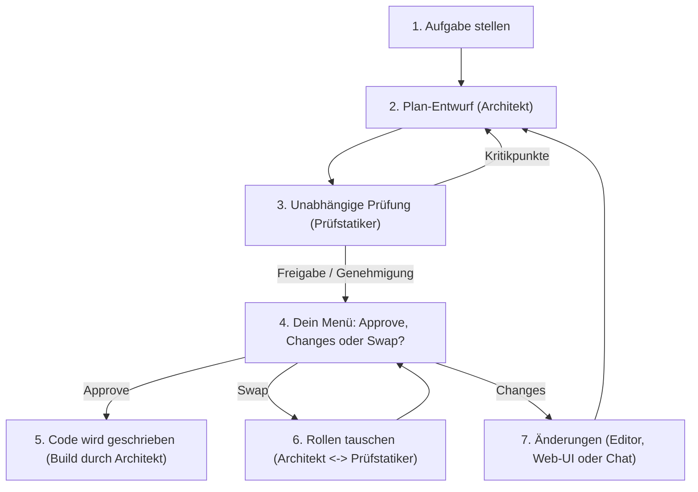
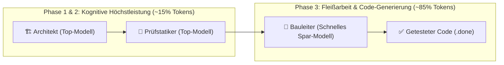
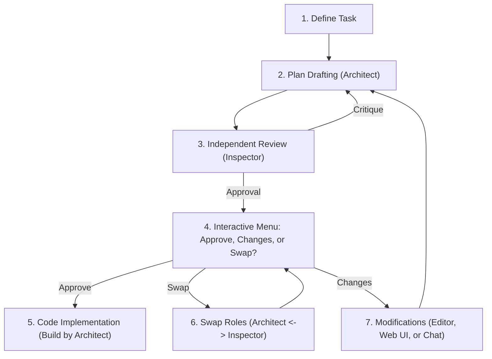
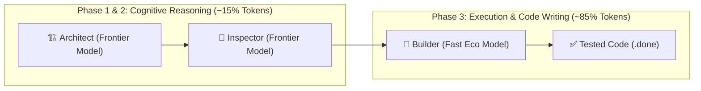

# ClaudeGravity Loop 🚀

> **Cross-Model Dual-Loop für Claude Code & Google Antigravity (`agy` / `gemini`).**  
> Verhindert KI-Betriebsblindheit durch ein unabhängiges 4-Augen-Prinzip: *Wer den Plan entwirft oder Code baut, darf ihn niemals selbst benoten.*

---

## 📑 Inhaltsverzeichnis / Table of Contents
* [🇩🇪 Deutsche Dokumentation (Für Einsteiger & Anfänger)](#-deutsche-dokumentation-für-einsteiger)
  * [1. Was ist ClaudeGravity Loop? (Einfach erklärt)](#1-was-ist-claudegravity-loop-einfach-erklärt)
  * [2. Architektur: Single-File Konzept (Kein Installer!)](#2-architektur-single-file-konzept-kein-installer)
  * [3. Installation & Globaler Befehl (`~/.local/bin/claudegravity`)](#3-installation--globaler-befehl-localbinclaudegravity)
  * [4. Voraussetzungen & KI-Prüfung (`--check`)](#4-voraussetzungen--ki-prüfung---check)
  * [5. Die wichtigsten Befehle auf einen Blick (Spickzettel)](#5-die-wichtigsten-befehle-auf-einen-blick-spickzettel)
  * [6. Schritt-für-Schritt: Dein erster Durchlauf](#6-schritt-für-schritt-dein-erster-durchlauf)
  * [7. Das Menü: Plan freigeben oder ändern (Approve & Changes)](#7-das-menü-plan-freigeben-oder-ändern-approve--changes)
  * [8. Fragen-Modus: KIs stellen Fragen an dich (`-i` / `--ask`)](#8-fragen-modus-kis-stellen-fragen-an-dich--i----ask)
  * [9. Die 3 Rollen, Modell-Splitting & Kostensparen (`--strategy`, `--bauer-model`, `--dry-run`)](#9-die-3-rollen-modell-splitting--kostensparen---strategy---bauer-model---dry-run)
  * [10. Weitermachen nach Pause oder Absturz (`--resume`)](#10-weitermachen-nach-pause-oder-absturz---resume)
  * [11. Schreibrechte & der Autopilot (`--yolo`)](#11-schreibrechte--der-autopilot---yolo)
  * [12. Was passiert bei AI-Sitzungslimits? (Token-Limits & Audit)](#12-was-passiert-bei-ai-sitzungslimits-token-limits--kosten-audit)
  * [13. Wo liegen meine Dateien? (Saubere Ordnerstruktur)](#13-wo-liegen-meine-dateien-saubere-ordnerstruktur)
  * [14. Häufige Fragen & Fehlerbehebung (FAQ)](#14-häufige-fragen--fehlerbehebung-faq)
  * [15. ClaudeGravity MCP-Server & Universeller Optimierungs-Prompt (`mcp_server.py`)](#15-claudegravity-mcp-server--universeller-optimierungs-prompt-mcp_serverpy)
* [🇬🇧 English Documentation (Beginner's Guide)](#-english-documentation-for-beginners)
  * [1. What is ClaudeGravity Loop? (Explained Simply)](#1-what-is-claudegravity-loop-explained-simply)
  * [2. Architecture: Single-File Concept (Not an Installer!)](#2-architecture-single-file-concept-not-an-installer)
  * [3. Installation & Global Command Setup (`~/.local/bin/claudegravity`)](#3-installation--global-command-setup-localbinclaudegravity)
  * [4. Prerequisites & Verification (`--check`)](#4-prerequisites--verification---check)
  * [5. Quick Command Cheatsheet](#5-quick-command-cheatsheet)
  * [6. Step-by-Step: Your First Run](#6-step-by-step-your-first-run)
  * [7. Plan Approval & Changes Menu](#7-plan-approval--changes-menu)
  * [8. Interview Mode: AIs Ask You Questions (`-i` / `--ask`)](#8-interview-mode-ais-ask-you-questions--i----ask)
  * [9. 3-Role Architecture, Model Splitting & Cost Economics (`--strategy`, `--bauer-model`, `--dry-run`)](#9-3-role-architecture-model-splitting--cost-economics---strategy---bauer-model---dry-run)
  * [10. Crash Recovery & Resuming (`--resume`)](#10-crash-recovery--resuming---resume)
  * [11. File Permissions & Autopilot (`--yolo`)](#11-file-permissions--autopilot---yolo)
  * [12. What Happens When AI Limits Are Hit? (Session Limits & Cost Audit)](#12-what-happens-when-ai-limits-are-hit-session-limits--cost-audit)
  * [13. Directory Structure & File Storage](#13-directory-structure--file-storage)
  * [14. Frequently Asked Questions (FAQ)](#14-frequently-asked-questions-faq)
  * [15. ClaudeGravity MCP Server & Universal Optimization Prompt (`mcp_server.py`)](#15-claudegravity-mcp-server--universal-optimization-prompt-mcp_serverpy)

---

# 🇩🇪 Deutsche Dokumentation (Für Einsteiger)

---

### 1. Was ist ClaudeGravity Loop? (Einfach erklärt)

Stell dir eine Baustelle vor:
* **Der Architekt (z. B. Claude Code):** Zeichnet den Bauplan und baut das Haus (Planung & Bau).
* **Der Prüfstatiker (z. B. Antigravity / Gemini):** Prüft den Plan völlig unabhängig auf Einsturzgefahr, Sicherheitslücken und vergessene Details (Prüfung & Review).
* **Flexible Rollenverteilung:** Standardmäßig ist Claude der Architekt und Antigravity der Prüfstatiker. Mit `--swap` (oder direkt im Plan-Freigabe-Menü mit `[3] Swap`) kannst du die Rollen jederzeit umdrehen!

Wenn eine Programmier-KI ihre eigenen Pläne prüft, übersieht sie eigene Denkfehler (*Confirmation Bias*). **ClaudeGravity Loop** lässt zwei KIs als eingespieltes Team arbeiten:
1. **Der Architekt** schreibt den Plan.
2. **Der Prüfstatiker** grillt und prüft den Plan schonungslos.
3. Erst wenn der Plan wasserdicht ist (oder du ihn freigibst), wird der Code geschrieben und getestet.
4. **Keine Zusatzkosten:** Nutzt deine vorhandenen Terminal-CLIs mit deinen normalen Abos – keine teuren API-Keys nötig!



---

### 2. Architektur: Single-File Konzept (Kein Installer!)

**`loop.py` ist das gesamte Programm – es ist KEIN Installer!**

* **Alles in einer Datei:** Die gesamte Logik (Erkennung der KIs, Planung, Prüfung, Menüs, Tests, Wiederaufnahme) steckt komplett in `loop.py`.
* **Keine extra Pakete:** Es wird kein `pip install` oder virtuelles Environment benötigt. Es nutzt ausschließlich die Standardbibliothek von Python 3.10+.
* **Sofortige Updates:** Jede Änderung an `loop.py` ist im gesamten System sofort live aktiv.

---

### 3. Installation & Globaler Befehl (`~/.local/bin/claudegravity`)

Damit du den Befehl `claudegravity` bequem in **jedem beliebigen Ordner** deines Computers aufrufen kannst, wird eine Verknüpfung (Symlink) in deinem Benutzer-Befehlsverzeichnis angelegt:

```bash
# 1. In das geklonte Repository wechseln:
cd ~/Projekte/claudegravity-loop

# 2. Datei als ausführbar markieren:
chmod +x loop.py

# 3. Globalen Symlink anlegen:
mkdir -p ~/.local/bin
ln -sf ~/Projekte/claudegravity-loop/loop.py ~/.local/bin/claudegravity
ln -sf ~/Projekte/claudegravity-loop/loop.py ~/.local/bin/claudegravity-loop
```

*(Hinweis: `~/.local/bin` ist unter modernen Linux- und Mac-Systemen standardmäßig im Suchpfad `$PATH` enthalten. Falls der Befehl nicht sofort gefunden wird, öffne ein neues Terminalfenster).*

---

### 4. Voraussetzungen & KI-Prüfung (`--check` / `--info`)

Du benötigst lediglich:
1. **Python 3.10 oder neuer** (auf fast jedem Linux/Mac bereits vorinstalliert).
2. Mindestens zwei dieser KIs im Terminal angemeldet:
   * **Claude Code** (`claude`)
   * **Google Antigravity** (`agy`) oder **Gemini CLI** (`gemini`)

Prüfe deine Installation und sieh dir die genauen Standard-Modelle an mit:
```bash
claudegravity --info
# oder:
claudegravity --check
```

---

### 5. Die wichtigsten Befehle auf einen Blick (Spickzettel)

| Befehl | Wofür wird er benutzt? |
| :--- | :--- |
| `claudegravity --info` / `--check` | Zeigt Standardmodelle, die 3 Rollen (Architekt, Prüfer, Bauleiter) und Optionen |
| `claudegravity "Aufgabe"` | Startet den Loop im aktuellen Ordner (Claude = Architekt, Antigravity = Prüfstatiker) |
| `claudegravity --strategy eco "Aufgabe"` | **Eco-Modus:** Spart bis zu 70% Token-Kosten durch Modell-Splitting zwischen Plan und Bau |
| `claudegravity --strategy best-code "Aufgabe"` | **Qualitäts-Modus:** Höchste Code-Präzision & tiefes Thinking auf Flaggschiff-Modellen |
| `claudegravity --dry-run "Aufgabe"` | **Trockenlauf:** Zeigt Rollen, Modelle, Kostenanalyse und Befehl ohne Ausführung |
| `claudegravity --bauer-model haiku "Aufgabe"` | **Gezieltes Bau-Modell:** Separates Modell für den autonomen Bau-Loop (Phase 3) |
| `claudegravity --swap "Aufgabe"` | **Rollen tauschen:** Antigravity plant/baut (Architekt), Claude prüft (Prüfstatiker) |
| `claudegravity -i "Aufgabe"` | **Fragen-Modus:** Beide KIs stellen dir Rückfragen bei Unklarheiten |
| `claudegravity --effort max "Aufgabe"` | Thinking/Reasoning-Intensität festlegen (`low` bis `max`) |
| `claudegravity --yolo "Aufgabe"` | **Autopilot:** Startet direkt mit vollen Schreibrechten (keine Nachfragen) |
| `claudegravity --architekt agy --pruefstatiker claude "Aufgabe"` | KIs für Architekt und Prüfstatiker explizit zuweisen |
| `claudegravity -p /pfad/zum/projekt "Aufgabe"` | Führt die Aufgabe in einem anderen Projektordner aus |
| `claudegravity --resume` oder `claudegravity -c` | Setzt eine unterbrochene Sitzung exakt an gleicher Stelle fort |
| `claudegravity --auto-switch "Aufgabe"` | **Auto-Fallback:** Wechselt bei Kontingentlimit nahtlos zum Alternativmodell |

---

### 6. Schritt-für-Schritt: Dein erster Durchlauf

1. **Öffne dein Terminal** und wechsle in dein Wunsch-Projekt:
   ```bash
   cd ~/Projekte/mein-projekt
   ```

2. **Starte den Loop mit deiner Aufgabe:**
   ```bash
   claudegravity "Refaktoriere das Spielplan-Modul und erstelle Unit-Tests"
   ```

3. **Was jetzt automatisch passiert:**
   * **Phase 1 (Plan):** Claude liest dein Projekt und schreibt einen Schritt-für-Schritt-Plan.
   * **Phase 2 (Review):** Antigravity liest den Plan, sucht nach Fehlern und gibt sein Urteil ab (`APPROVED` oder `REVISE`). Bei Kritik bessert Claude den Plan automatisch nach (maximal 2 Runden, um Tokens zu schonen).
   * **Plan-Freigabe:** Sobald der Plan fertig ist, stoppt das Tool und zeigt dir das Menü.

---

### 7. Das Menü: Plan freigeben oder ändern (Approve, Changes & Swap)

Sobald Phase 2 abgeschlossen ist, erscheint dieses Menü:

```text
============================================================
📋 PLAN-STATUS: Fertiggestellt & Geprüft
📄 Aktuelle Plan-Datei             : .dual-loop/sessions/<session>/PLAN_v2.md
🏗️ Architekt (Planung & Bau)       : Claude Code (`claude-sonnet-5`)
🧐 Prüfstatiker (Prüfung & Review) : Antigravity (agy) (`gemini-2.5-pro`) [high]
============================================================
Möchtest du den Plan freigeben, Rollen tauschen oder Änderungen vornehmen?
  [1] Approve  -> Plan genehmigen & weiter zur Implementierung
  [2] Changes  -> Änderungen/Feedback anbringen
  [3] Swap     -> Rollen tauschen (Architekt <-> Prüfstatiker)
  [4] Anzeigen -> Plan direkt hier im Terminal lesen
  [5] Beenden  -> Abbrechen (Fortsetzen später mit --resume möglich)
------------------------------------------------------------
Auswahl [1/2/3/4/5] (Standard: 1):
```

* **[1] Approve:** Der Architekt beginnt sofort mit dem Bauen in Phase 3.
* **[3] Swap:** Tauscht die Rollen direkt im Flug! Wenn du z.B. möchtest, dass Antigravity den Bau übernimmt und Claude als Prüfer fungiert, wähle einfach `[3]`.
* **[2] Changes:** Öffnet das Change-Routing-Menü:

```text
[UI-Varianten (Graphische Oberfläche)]:
  [1] Im Editor öffnen (VS Code / Antigravity / Cursor / System)
      -> Öffnet die Plan-Datei direkt im Editor zum manuellen Anpassen
  [2] Claude UI (Web / Desktop)
      -> Zeigt dir den Pfad zum Kopieren in deine Claude Web-UI

[CLI-Varianten (Terminal)]:
  [3] Feedback direkt hier eintippen
      -> Tippe z. B.: "Nimm PostgreSQL statt SQLite". Die KI baut den Plan um!
  [4] Interaktive Claude Code CLI-Session (Architekt) starten
  [5] Interaktive Antigravity CLI-Session (Prüfstatiker) starten
  [6] Zurück zum Hauptmenü
```

---

### 8. Fragen-Modus: KIs stellen Fragen an dich (`-i` / `--ask`)

Wenn du eine Aufgabe hast, bei der wichtige Entscheidungen oder Annahmen nötig sind, aktiviere den Fragen-Modus mit `-i` (oder `--ask`):

```bash
claudegravity -i "Baue ein Benachrichtigungssystem"
```

Beide KIs binden dich gezielt ein:
1. **Architekt (Claude):** Stellt dir bis zu 3 konkrete Rückfragen (z.B. Mail vs. Push, Datenformat), bevor der Entwurf finalisiert wird. Du antwortest direkt im Terminal.
2. **Prüfstatiker (Antigravity):** Prüft den Plan und stellt bei Zielkonflikten oder Sicherheitsrisiken Rückfragen an dich. Deine Antworten fließen direkt in Runde 2 des Plans ein.

---

### 9. Die 3 Rollen, Modell-Splitting & Kostensparen (`--strategy`, `--bauer-model`, `--dry-run`)

Warum müssen Planung und Bau nicht das gleiche Modell sein? **Weil eine Trennung massiv Kosten spart!**

#### 💡 Das Kostenspar-Prinzip (Planung vs. Bau):
* **Phase 1 (Architekt) & Phase 2 (Prüfstatiker):** Benötigen tiefes Denkvermögen (Reasoning), verbrauchen aber **nur 10–15% der gesamten Tokens** (~2.000 bis 4.000 Tokens für `PLAN.md` und `REVIEW.md`). Hier lohnt sich ein Spitzenmodell (z. B. Claude Sonnet 3.7 / Opus oder Gemini 2.5 Pro mit hohem Effort), um Denkfehler von vornherein auszuschließen.
* **Phase 3 (Bauleiter / Coder):** Liest und schreibt ganze Dateien, führt Tests aus, behebt Linter-Fehler und iteriert mehrfach. **Dieser Schritt macht 85–90% aller Tokens und Kosten aus!**
* **Der Spareffekt:** Wenn für Phase 3 ein schnelles Spar-Modell eingesetzt wird (z. B. `claude-3-5-haiku` oder `gemini-2.5-flash`), sparst du **bis zu 70% deiner Token-Kosten**, während die Architektur durch die Prüfung auf absolutem Profi-Niveau bleibt!



#### 🎯 Die 3 Strategie-Profile (`--strategy`):
* `--strategy eco`: **Maximale Ersparnis!** Top-Modelle für Plan & Review, aber blitzschnelles Spar-Modell für Phase 3 (z. B. Haiku oder Flash). Spart bis zu 70% Kontingent!
* `--strategy best-code`: **Maximale Qualität!** Nutzt durchgehend Spitzenmodelle mit intensivem Thinking-Effort auf allen Ebenen.
* `--strategy balanced`: **Ausgewogener Standard** (Standardbelegung).

#### 🔍 Trockenlauf (`--dry-run`):
Prüfe vorab die gewählten Rollen, Modelle und Kosten ohne Dateien anzufassen:
```bash
claudegravity --dry-run "Refaktoriere Spielplan-Modul" --strategy eco
```

#### 🔄 Rollen tauschen (`--swap`):
* Standard: **Architekt** = Claude Code (Planung & Bau) | **Prüfstatiker** = Antigravity (Prüfung & Review)
* Mit `--swap` kehrst du das Team um:
  ```bash
  claudegravity --swap "Baue ein Benachrichtigungssystem"
  ```
  Jetzt plant **Antigravity**, während **Claude Code** als unbestechlicher Prüfstatiker fungiert!

#### 🛠️ KIs und Modelle gezielt zuweisen:
* `--architekt <claude|agy|gemini>` (oder `--planner`): KI für den Entwurf (Phase 1).
* `--pruefstatiker <agy|claude|gemini>` (oder `--reviewer`): KI für das statische Review (Phase 2).
* `--bauer <claude|agy|gemini>` (oder `--builder`): KI für die Umsetzung (Phase 3).
* `--architekt-model <name>`: Modell für Planung (z. B. `sonnet`, `opus`, `gemini-2.5-pro`).
* `--pruefstatiker-model <name>`: Modell für Prüfung (z. B. `gemini-2.5-pro`, `sonnet`).
* `--bauer-model <name>`: Modell für den Bau (z. B. `claude-3-5-haiku`, `gemini-2.5-flash`).

#### 🧠 Reasoning-Effort (Thinking-Intensität):
* `--effort <low|medium|high|xhigh|max>`: Globale Denk-Intensität.
* `--pruefstatiker-effort <effort>`: Spezifische Prüf-Intensität für Antigravity (z.B. `high` oder `max` für tiefste Sicherheitsanalysen).
* `--architekt-effort <effort>`: Spezifische Intensität für den Architekten.
* `--bauer-effort <effort>`: Spezifische Intensität für den Bauleiter.

**Beispiel mit maximaler Ersparnis und Fragen-Modus:**
```bash
claudegravity --strategy eco -i "Refaktoriere das Spielplan-Modul"
```

---

### 10. Weitermachen nach Pause oder Absturz (`--resume`)

Wurde der PC ausgeschaltet, das Terminal geschlossen oder hast du mit `Ctrl+C` abgebrochen? **Keine Sorge, nichts geht verloren!**

Tippe einfach:
```bash
claudegravity --resume
# oder kurz:
claudegravity -c
```
Das Skript liest die gespeicherte `state.json` aus dem Session-Ordner ein und macht **an genau der Stelle weiter**, an der gestoppt wurde (inklusive aller Modell- und Rolleneinstellungen).

---

### 11. Schreibrechte & der Autopilot (`--yolo`)

KIs laufen im Hintergrund ohne Fenster. Damit eine KI nicht unbemerkt Dateien verändert, verlangt das System normalerweise eine Bestätigung.

* **Standard:** Vor Phase 3 fragt dich das Skript:  
  *„Soll Claude Code volle Schreib-/Tool-Rechte erhalten? [J/n]“* (Drücke einfach `Enter`).
* **Autopilot (`--yolo`):** Wenn du gar nicht gefragt werden möchtest:
  ```bash
  claudegravity --yolo "Erstelle eine neue Funktion"
  ```
  Das Flag `--yolo` schaltet die Schreibrechte für den gesamten Durchlauf automatisch frei.

---

### 12. Was passiert bei AI-Sitzungslimits? (Token-Limits & Kosten-Audit)

Wenn Claude Code oder Antigravity an das persönliche Abonnements-Limit stößt (`You've hit your session limit · resets 3:20pm`), stürzt `claudegravity` **nicht** ab. Es sichert den Stand sofort in `state.json` und gibt dir die Wahl:
1. **Modell-Wechsel:** Das andere installierte Modell (z. B. `agy` statt `claude`) übernimmt sofort die Rolle und führt den Schritt nahtlos zu Ende.
2. **Warten per Countdown:** Wartet per Timer bis zur angegebenen Reset-Uhrzeit und setzt danach automatisch fort.
3. **Sauber beenden:** Sichert den Stand – du kannst später mit `claudegravity -c` weitermachen.

Mit `--auto-switch` (oder `--fallback`) wechselt das System bei Limits sogar vollautomatisch auf das Alternativ-Modell!

#### 📊 Automatischer Token- & Kostenbericht in `.done`:
Sobald eine Aufgabe abgeschlossen ist, trägt `claudegravity` die verbrauchten Tokens, Rollen, Modelle, Effort und geschätzten Kosten automatisch in die `.done`-Datei ein:

```markdown
---
### 📊 Ressourcen-Verbrauch & Kosten (ClaudeGravity Audit)
* **Gesamt-Tokens:** 24.850 Tokens
  * **Input-Tokens:** 21.600
  * **Output-Tokens:** 3.250
* **Entstandene Kosten (geschätzt):** ~$0.2400 USD
* **Aufschlüsselung nach Agent, Rolle, Modell & Effort:**
  * **Claude Code**
    * **Rolle:** 🏗️ Architekt (Planung & Bau)
    * **Modell:** `claude-sonnet-5`
    * **Reasoning-Effort:** `standard`
    * **Verbrauch:** 19.400 Tokens (Input: 16.500, Output: 2.900)
    * **Kosten:** ~$0.2400 USD
  * **Antigravity (agy)**
    * **Rolle:** 🧐 Prüfstatiker (Prüfung & Review)
    * **Modell:** `gemini-2.5-pro`
    * **Reasoning-Effort:** `high`
    * **Verbrauch:** 5.450 Tokens (Input: 5.100, Output: 350)
    * **Kosten:** Abo-Inklusivkontingent
* **Audit-Zeitstempel:** 2026-10-17 16:15:30
```

---

### 13. Wo liegen meine Dateien? (Saubere Ordnerstruktur)

In jedem Projekt, in dem du `claudegravity` ausführst, wird ein sauberer Ordner namens `.dual-loop/` angelegt. **Alle** Pläne, Reviews und Logs liegen isoliert im jeweiligen Session-Ordner:

```
mein-projekt/
├── .dual-loop/
│   └── sessions/                   # 📦 Revisionssicheres Archiv aller Aufgaben
│       └── 20261017_102220_task/
│           ├── state.json          # Sitzungs-Speicher für --resume
│           ├── .done               # 🏁 Fertigmeldung der Aufgabe (isoliert im Session-Ordner!)
│           ├── LOG.md              # 📜 Audit-Log der Review-Runden dieser Aufgabe
│           ├── PLAN_v1.md          # Erster Entwurf
│           ├── REVIEW_round1.md    # Kritik von Antigravity
│           ├── PLAN_v2.md          # Überarbeiteter Entwurf
│           └── REVIEW_round2.md
└── logs/                           # 💬 Ausführliche Terminal-Ausgaben
```

---

### 14. Häufige Fragen & Fehlerbehebung (FAQ)

**Kostet mich der Loop extra Geld?**  
Nein! Es werden ausschließlich deine bestehenden Abos deiner Terminal-Tools (`claude`, `agy`) genutzt. Es fallen keine API-Gebühren pro Token an.

**Was bedeutet `Maximale Review-Runden erreicht`?**  
Wenn sich die KIs nach 2 Runden nicht einig sind, bricht das Tool ab und fragt dich um Rat. Das spart Tokens und verhindert Endlosschleifen.

**Wie beende ich den Loop sicher?**  
Drücke einfach einmal `Ctrl+C`. Das Programm beendet die aktuelle Runde sauber und sichert den Zwischenstand ab.

---

### 15. ClaudeGravity MCP-Server & Universeller Optimierungs-Prompt (`mcp_server.py`)

In diesem Repository ist ein eigenständiger, installationsfreier **MCP-Server** (`mcp_server.py`) enthalten. Er benötigt nur die Python Standard-Bibliothek (kein `pip install` nötig) und kommuniziert über den offiziellen JSON-RPC 2.0 Standard.

#### 🛠️ Was kann der MCP-Server?
1. `claudegravity_optimize`: Analysiert jede Aufgabe auf Komplexität (Refactoring, Architektur, Bugfix) und ermittelt die optimale Modell-, Rollen- und Effort-Kombination (für maximale Qualität oder bis zu 70% Kostenersparnis). Gibt den fertigen Shell-Befehl aus.
2. `claudegravity_run`: Führt den optimierten Befehl direkt oder im Hintergrund aus.
3. `claudegravity_info`: Zeigt alle installierten AI-CLIs und Setup-Empfehlungen.

#### 🔌 Einbindung in Claude Code:
Füge den Server mit einem Befehl zu deiner Claude Code Installation hinzu:
```bash
claude mcp add claudegravity -- python3 /home/gordon/Projekte/claudegravity-loop/mcp_server.py
```

#### 🔌 Einbindung in Antigravity / Cursor / Gemini (`mcp.json`):
```json
{
  "mcpServers": {
    "claudegravity": {
      "command": "python3",
      "args": ["/home/gordon/Projekte/claudegravity-loop/mcp_server.py"]
    }
  }
}
```

#### 💻 Direkter Aufruf im Terminal (CLI-Optimizer):
Du kannst den Optimizer auch direkt im Terminal aufrufen, ohne einen MCP-Client zu starten:
```bash
# Günstigste Variante (bis zu 70% Ersparnis durch Modell-Splitting):
claudegravity-mcp --optimize "Refaktoriere Spielplan-Modul" --priority lowest-cost

# Höchste Codequalität (Frontier-Modelle mit hohem Thinking):
claudegravity-mcp --optimize "Baue ein sicheres Auth-Modul mit JWT" --priority best-code
```

#### 📋 Der Universelle Optimierungs-Prompt (Kopiervorlage):
Kopiere diesen Prompt in ein beliebiges Chat-Fenster (Claude Code, Antigravity, ChatGPT), um für jede Aufgabe sofort den optimalen Einzeiler-Befehl zu erhalten:

```markdown
Du bist ein Experte für ClaudeGravity Loop. Analysiere folgende Programmieraufgabe und gib mir den optimalen claudegravity-Befehl aus:

📌 Aufgabe: <HIER DEINE AUFGABE EINTRAGEN>
🎯 Priorität: [best-code (höchste Qualität) | lowest-cost (bis zu 70% Ersparnis) | balanced (ausgewogen)]

Beantworte kurz:
1. Analyse: Warum lohnt sich bei dieser Aufgabe die Trennung von Planung (Architekt) und Bau (Bauleiter)?
2. Rollenbelegung: Welche Modelle und Thinking-Efforts sind für Architekt, Prüfstatiker und Bauleiter ideal?
3. Befehl: Gib den exakten, ausführbaren Shell-Befehl als Einzeiler aus.
```

---
---

# 🇬🇧 English Documentation (For Beginners)

---

### 1. What is ClaudeGravity Loop? (Explained Simply)

Imagine a building construction site:
* **The Architect (e.g., Claude Code):** Drafts the blueprints and builds the structure (Plan & Build).
* **The Independent Inspector (e.g., Antigravity / Gemini):** Scrutinizes the blueprint for structural flaws, security vulnerabilities, and edge cases (Review & Audit).
* **Flexible Roles & Swapping:** By default, Claude is the Architect and Antigravity is the Inspector. You can swap roles anytime using `--swap` or directly in the approval menu (`[3] Swap`)!

When an AI evaluates its own plans, it suffers from *confirmation bias*. **ClaudeGravity Loop** pairs two independent AIs:
1. **The Architect** drafts the plan.
2. **The Inspector** ruthlessly stress-tests and reviews the plan.
3. Once approved, the code is implemented and verified.
4. **Zero API Fees:** Runs through your existing terminal subscriptions—no expensive per-token API keys required!



---

### 2. Architecture: Single-File Concept (Not an Installer!)

**`loop.py` is the entire application—it is NOT an installer!**

* **Everything in one file:** All orchestration logic (AI CLI detection, planning, adversarial review, approval menus, autonomous build loop, crash recovery) lives directly inside `loop.py`.
* **Zero dependencies:** No `pip install` or virtual environments required. It uses standard Python 3.10+ libraries only.
* **Instant updates:** Any change made to `loop.py` is immediately live across your entire system.

---

### 3. Installation & Global Command Setup (`~/.local/bin/claudegravity`)

To run `claudegravity` conveniently from **any directory** on your machine, create a symlink in your user binaries folder:

```bash
# 1. Navigate to the repository:
cd ~/Projekte/claudegravity-loop

# 2. Make the script executable:
chmod +x loop.py

# 3. Create global symlinks:
mkdir -p ~/.local/bin
ln -sf ~/Projekte/claudegravity-loop/loop.py ~/.local/bin/claudegravity
ln -sf ~/Projekte/claudegravity-loop/loop.py ~/.local/bin/claudegravity-loop
```

*(Note: `~/.local/bin` is already part of `$PATH` on most Linux and macOS systems. If the command is not immediately recognized, open a fresh terminal).*

---

### 4. Prerequisites & Verification (`--check` / `--info`)

You only need:
1. **Python 3.10+** (preinstalled on Linux and macOS).
2. At least two AI CLIs logged in on your system:
   * **Claude Code** (`claude`)
   * **Google Antigravity** (`agy`) or **Gemini CLI** (`gemini`)

Verify your installation and see exact default model assignments with:
```bash
claudegravity --info
# or:
claudegravity --check
```

---

### 5. Quick Command Cheatsheet

| Command | Description |
| :--- | :--- |
| `claudegravity --info` / `--check` | Verify installed AIs, default models, the 3 roles, and options |
| `claudegravity "Task"` | Run task in the current folder (Claude = Architect, Antigravity = Inspector) |
| `claudegravity --strategy eco "Task"` | **Eco Mode:** Cut up to 70% token costs by model splitting between plan and build |
| `claudegravity --strategy best-code "Task"` | **Quality Mode:** Maximum code quality and deep thinking across all frontier models |
| `claudegravity --dry-run "Task"` | **Dry Run:** Preview roles, models, cost analysis, and exact command without running |
| `claudegravity --bauer-model haiku "Task"` | **Targeted Build Model:** Dedicated fast/cheap model for Phase 3 build loop |
| `claudegravity --swap "Task"` | **Swap Roles:** Antigravity plans (Architect), Claude reviews (Inspector) |
| `claudegravity -i "Task"` | **Interview Mode:** Both AIs ask clarifying questions if anything is ambiguous |
| `claudegravity --effort max "Task"` | Set reasoning/thinking effort (`low` to `max`) |
| `claudegravity --yolo "Task"` | **Autopilot:** Run hands-free with full tool permissions granted automatically |
| `claudegravity --architekt agy --pruefstatiker claude "Task"` | Explicitly assign AIs for Architect and Inspector roles |
| `claudegravity -p /path/to/project "Task"` | Run the task in an external project directory |
| `claudegravity --resume` or `claudegravity -c` | Resume an interrupted session exactly where it stopped |
| `claudegravity --auto-switch "Task"` | **Auto-Fallback:** Automatically switch to alternative model if limit reached |

---

### 6. Step-by-Step: Your First Run

1. Open your terminal and navigate to your project:
   ```bash
   cd ~/Projekte/my-project
   ```

2. Run your task:
   ```bash
   claudegravity "Refactor tournament module and add unit tests"
   ```

3. **What happens automatically:**
   * **Phase 1 (Plan):** Claude inspects the codebase and drafts a step-by-step roadmap.
   * **Phase 2 (Review):** Antigravity reviews the plan and flags risks. Claude refines the plan if needed (max 2 rounds to conserve tokens).
   * **Plan Approval:** Once ready, the tool pauses and displays the interactive approval menu.

---

### 7. Plan Approval & Changes Menu (Approve, Changes & Swap)

When Phase 2 finishes, you will see this menu:

```text
============================================================
📋 PLAN STATUS: Completed & Reviewed
📄 Current Plan File               : .dual-loop/sessions/<session>/PLAN_v2.md
🏗️ Architect (Plan & Build)       : Claude Code (`claude-sonnet-5`)
🧐 Structural Inspector (Review)   : Antigravity (agy) (`gemini-2.5-pro`) [high]
============================================================
What would you like to do?
  [1] Approve  -> Approve plan & proceed to implementation
  [2] Changes  -> Request modifications/feedback
  [3] Swap     -> Swap roles (Architect <-> Inspector)
  [4] View     -> Read plan directly in terminal
  [5] Exit     -> Cancel (can be resumed later with --resume)
------------------------------------------------------------
Choice [1/2/3/4/5] (Default: 1):
```

* **[1] Approve:** The Architect immediately starts implementing the plan in Phase 3.
* **[3] Swap:** Invert roles on the fly! If Claude designed the blueprint but you want Antigravity to write the code and Claude to audit, simply choose `[3]`.
* **[2] Changes:** Opens the change routing menu:

```text
[UI Options (Graphical Interfaces)]:
  [1] Open in Editor (VS Code / Antigravity / Cursor / System)
      -> Opens the plan file directly in your editor for quick manual edits
  [2] Claude UI (Web / Desktop)
      -> Displays file path to copy/paste into Claude Web UI

[CLI Options (Terminal)]:
  [3] Type feedback directly here
      -> E.g. "Use PostgreSQL instead of SQLite". The AI rewrites the plan!
  [4] Launch interactive Claude Code CLI session (Architect)
  [5] Launch interactive Antigravity CLI session (Inspector)
  [6] Return to main menu
```

---

### 8. Interview Mode: AIs Ask You Questions (`-i` / `--ask`)

When working on complex tasks with trade-offs or architectural decisions, activate Interview Mode:

```bash
claudegravity -i "Build an authentication service"
```

Both agents will interact with you directly:
1. **Architect (Claude):** Asks up to 3 specific clarifying questions before finalizing the roadmap. You answer in the terminal.
2. **Structural Inspector (Antigravity):** Highlights critical edge cases or trade-offs and asks for your guidance. Your answers are passed into Plan Round 2.

---

### 9. 3-Role Architecture, Model Splitting & Cost Economics (`--strategy`, `--bauer-model`, `--dry-run`)

Do planning and building have to be the exact same model? **No! In fact, separating them cuts up to 70% of your token costs and quota!**

#### 💡 The Cost-Saving Economics (Plan vs. Build):
* **Phase 1 (Architect) & Phase 2 (Inspector):** High cognitive complexity and reasoning, but consumes **only 10–15% of total session tokens** (~2,000 to 4,000 tokens for `PLAN.md` and `REVIEW.md`). Using a top-tier frontier model here (e.g. Claude 3.7 Sonnet / Opus or Gemini 2.5 Pro with high effort) ensures flawless system design without breaking the bank.
* **Phase 3 (Autonomous Builder / Coder):** Heavy-duty lifting—reading large files, writing implementations, running test suites, resolving linters across multiple iterations. **Accounts for 85–90% of total tokens and API costs!**
* **The Savings:** By offloading Phase 3 to a fast, cost-effective workhorse (e.g., `claude-3-5-haiku` or `gemini-2.5-flash`), you save **up to 70% in token costs and quota**, while the codebase still maintains the rock-solid architecture designed by the frontier models!



#### 🎯 Strategy Presets (`--strategy`):
* `--strategy eco`: **Maximum Savings!** Frontier models for Plan & Review, ultra-fast eco model for Phase 3 (e.g. Haiku or Flash). Saves up to 70% quota!
* `--strategy best-code`: **Maximum Quality!** All phases run on top-tier frontier models with high thinking effort.
* `--strategy balanced`: **Balanced Default** (default setup).

#### 🔍 Dry Run (`--dry-run`):
Preview the assigned roles, models, and cost analysis without modifying any files:
```bash
claudegravity --dry-run "Refactor payment module" --strategy eco
```

#### 🔄 Swapping Roles (`--swap`):
* Default: **Architect** = Claude Code (Plan & Build) | **Inspector** = Antigravity (Review & Audit)
* Invert the team with `--swap`:
  ```bash
  claudegravity --swap "Build an authentication service"
  ```
  Now **Antigravity** acts as the Architect, and **Claude Code** acts as the rigorous Inspector!

#### 🛠️ Explicitly Assigning AIs & Models:
* `--architekt <claude|agy|gemini>` (or `--planner`): AI for drafting (Phase 1).
* `--pruefstatiker <agy|claude|gemini>` (or `--reviewer`): AI for independent review (Phase 2).
* `--bauer <claude|agy|gemini>` (or `--builder`): AI for implementation (Phase 3).
* `--architekt-model <name>`: Model for the Architect (e.g. `sonnet`, `opus`, `gemini-2.5-pro`).
* `--pruefstatiker-model <name>`: Model for the Inspector (e.g. `gemini-2.5-pro`, `sonnet`).
* `--bauer-model <name>`: Model for the Builder (e.g. `claude-3-5-haiku`, `gemini-2.5-flash`).

#### 🧠 Reasoning Effort (Thinking Intensity):
* `--effort <low|medium|high|xhigh|max>`: Global thinking effort.
* `--pruefstatiker-effort <effort>`: Specific reasoning effort for the Inspector.
* `--architekt-effort <effort>`: Specific reasoning effort for the Architect.
* `--bauer-effort <effort>`: Specific reasoning effort for the Builder.

**Example with maximum savings and interview mode:**
```bash
claudegravity --strategy eco -i "Refactor payment module"
```

---

### 10. Crash Recovery & Resuming (`--resume`)

If your terminal closes, your computer restarts, or you pressed `Ctrl+C`, **no progress is lost!**

Simply run:
```bash
claudegravity --resume
# or:
claudegravity -c
```
It reads the session state from `state.json` and resumes execution right where it stopped (including all model and role configurations).

---

### 11. File Permissions & Autopilot (`--yolo`)

Headless AI tools require permissions to modify files on disk.

* **Interactive:** Before Phase 3, you are asked: *„Grant full write permissions? [J/n]“* (simply press `Enter`).
* **Autopilot (`--yolo`):** Skip the question completely:
  ```bash
  claudegravity --yolo "Refactor module"
  ```

---

### 12. What Happens When AI Limits Are Hit? (Session Limits & Cost Audit)

If Claude Code or Antigravity hits a personal subscription limit (`You've hit your session limit · resets 3:20pm`), `claudegravity` does **not** crash. It safely saves state and offers 3 options:
1. **Model Switch:** The alternative installed model (e.g. `agy` taking over for `claude`) seamlessly finishes the task.
2. **Wait Timer:** Waits with a live countdown until the reset time and resumes automatically.
3. **Safe Exit:** Cleanly saves progress so you can resume later with `claudegravity -c`.

With `--auto-switch` (or `--fallback`), the tool will automatically failover to the alternative model without blocking!

#### 📊 Automatic Token & Cost Audit in `.done`:
When the task finishes, `claudegravity` automatically audits consumed tokens, roles, models, effort, and estimated costs directly into the session's `.done` file:

```markdown
---
### 📊 Ressourcen-Verbrauch & Kosten (ClaudeGravity Audit)
* **Gesamt-Tokens:** 24.850 Tokens
  * **Input-Tokens:** 21.600
  * **Output-Tokens:** 3.250
* **Entstandene Kosten (geschätzt):** ~$0.2400 USD
* **Aufschlüsselung nach Agent, Rolle, Modell & Effort:**
  * **Claude Code**
    * **Rolle:** 🏗️ Architekt (Planung & Bau)
    * **Modell:** `claude-sonnet-5`
    * **Reasoning-Effort:** `standard`
    * **Verbrauch:** 19.400 Tokens (Input: 16.500, Output: 2.900)
    * **Kosten:** ~$0.2400 USD
  * **Antigravity (agy)**
    * **Rolle:** 🧐 Prüfstatiker (Prüfung & Review)
    * **Modell:** `gemini-2.5-pro`
    * **Reasoning-Effort:** `high`
    * **Verbrauch:** 5.450 Tokens (Input: 5.100, Output: 350)
    * **Kosten:** Abo-Inklusivkontingent
* **Audit-Zeitstempel:** 2026-10-17 16:15:30
```

---

### 13. Directory Structure & File Storage

All plans, audits, and sessions are safely stored in `.dual-loop/`. Every file belongs strictly to its task session:

```
my-project/
├── .dual-loop/
│   └── sessions/                   # 📦 Clean, versioned task archive
│       └── 20261017_102220_task/
│           ├── state.json          # Session state for --resume
│           ├── .done               # 🏁 Task completion marker (isolated in session!)
│           ├── LOG.md              # 📜 Audit log of review rounds
│           ├── PLAN_v1.md          # Initial roadmap
│           ├── REVIEW_round1.md    # Critique by reviewer
│           ├── PLAN_v2.md          # Revised roadmap
│           └── REVIEW_round2.md
└── logs/                           # 💬 Detailed terminal execution logs
```

---

### 14. Frequently Asked Questions (FAQ)

**Does this cost extra API fees?**  
No! It runs through your official terminal CLIs (`claude`, `agy`) using your active personal subscriptions.

**What happens if models disagree?**  
To prevent token waste, reviews are capped at 2 rounds. If disagreement persists, the tool pauses and asks you for guidance.

**How do I safely stop a running loop?**  
Press `Ctrl+C` once. The runner cleanly wraps up the current step and saves the state so you can resume later.

---

### 15. ClaudeGravity MCP Server & Universal Optimization Prompt (`mcp_server.py`)

This repository includes a standalone, zero-dependency **MCP Server** (`mcp_server.py`). It requires only the Python standard library (no `pip install` needed) and speaks the official JSON-RPC 2.0 stdio protocol.

#### 🛠️ Available MCP Tools:
1. `claudegravity_optimize`: Analyzes task complexity (refactoring, architecture, bugfix) and calculates the optimal model, role, and effort configuration (for highest quality or up to 70% cost savings). Outputs the ready-to-execute shell command.
2. `claudegravity_run`: Executes the optimized command directly or detached in the background.
3. `claudegravity_info`: Inspects system CLIs and status.

#### 🔌 Connecting to Claude Code:
Add the server with a single command to your Claude Code setup:
```bash
claude mcp add claudegravity -- python3 /home/gordon/Projekte/claudegravity-loop/mcp_server.py
```

#### 🔌 Connecting to Antigravity / Cursor / Gemini (`mcp.json`):
```json
{
  "mcpServers": {
    "claudegravity": {
      "command": "python3",
      "args": ["/home/gordon/Projekte/claudegravity-loop/mcp_server.py"]
    }
  }
}
```

#### 💻 Direct Terminal Usage (CLI Optimizer):
You can also run the optimizer directly from your shell without an MCP client:
```bash
# Maximum economy (up to 70% savings via model splitting):
claudegravity-mcp --optimize "Refactor payment module" --priority lowest-cost

# Maximum code quality (frontier models with deep reasoning):
claudegravity-mcp --optimize "Build JWT auth module with tests" --priority best-code
```

#### 📋 Universal Optimization Prompt (Copy & Paste):
Copy and paste this prompt into any AI chat (Claude Code, Antigravity, ChatGPT) to instantly generate the optimal one-liner command:

```markdown
You are an expert on ClaudeGravity Loop. Analyze the following programming task and generate the optimal claudegravity command:

📌 Task: <ENTER YOUR TASK HERE>
🎯 Priority: [best-code (highest quality) | lowest-cost (up to 70% savings) | balanced (default)]

Briefly answer:
1. Analysis: Why does splitting Planning (Architect) and Building (Builder) save up to 70% token costs for this task?
2. Role Assignment: Which models and thinking effort levels are ideal for Architect, Inspector, and Builder?
3. Command: Output the exact, executable one-liner shell command.
```

---

## 📄 License
MIT License. Free and Open Source.
