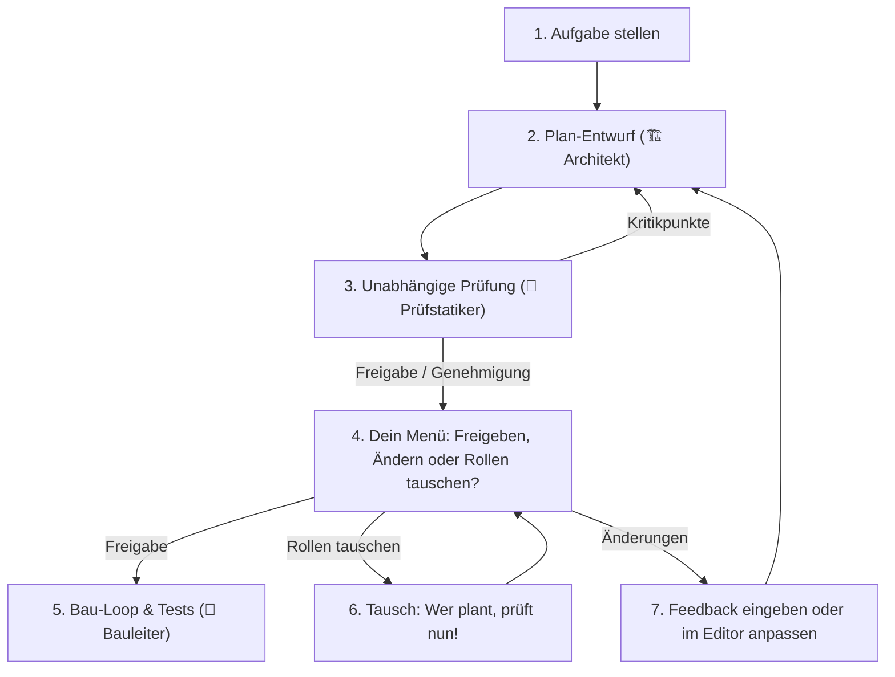

# ClaudeGravity Loop 🚀

> **Universeller Cross-Model Dual-Loop für Claude Code, Google Antigravity, OpenAI Codex, GitHub Copilot & lokale Modelle (Ollama, LM Studio, Intranet wie ai.gb-web.de).**  
> Verhindert KI-Betriebsblindheit durch ein unabhängiges 4-Augen-Prinzip: *Wer den Plan entwirft oder Code baut, darf ihn niemals selbst benoten.*  
> **Plattformunabhängig:** Läuft nativ auf **Windows, macOS und Linux** ohne zusätzliche Installation (`pip install` ist nicht nötig!).

---

## 📑 Inhaltsverzeichnis / Table of Contents

* [🇩🇪 Deutsche Dokumentation](#-deutsche-dokumentation)
  * [🟢 Stufe 1: Kinderleichter Start (In 60 Sekunden loslegen)](#-stufe-1-kinderleichter-start-in-60-sekunden-loslegen)
    * [1.1 Was macht ClaudeGravity? (Einfach erklärt)](#11-was-macht-claudegravity-einfach-erklärt)
    * [1.2 Installation für Windows, macOS und Linux](#12-installation-für-windows-macos-und-linux)
    * [1.3 Dein erster Befehl (Loslegen!)](#13-dein-erster-befehl-loslegen)
  * [🟡 Stufe 2: Cloud + Lokale Modelle & Firmen-Netzwerk (Ollama, LM Studio, ai.gb-web.de)](#-stufe-2-cloud--lokale-modelle--firmen-netzwerk)
    * [2.1 Das geniale 0-Euro-Kombi-Modell (`--strategy local-free`)](#21-das-geniale-0-euro-kombi-modell---strategy-local-free)
    * [2.2 Lokale Modelle mit Ollama oder LM Studio verbinden](#22-lokale-modelle-mit-ollama-oder-lm-studio-verbinden)
    * [2.3 Eigene Netzwerk- & Intranet-Server einbinden (z. B. `https://ai.gb-web.de/`)](#23-eigene-netzwerk---intranet-server-einbinden)
  * [🔴 Stufe 3: Profi-Spielwiese & Power-Features](#-stufe-3-profi-spielwiese--power-features)
    * [3.1 Die 3-Rollen-Architektur (Architekt, Prüfstatiker, Bauleiter)](#31-die-3-rollen-architektur)
    * [3.2 Strategie-Presets (`best-code`, `eco`, `local-free`, `balanced`)](#32-strategie-presets)
    * [3.3 Trockenlauf (`--dry-run`)](#33-trockenlauf---dry-run)
    * [3.4 Auto-Switch bei Raten- und Kontingentlimits (`--auto-switch`)](#34-auto-switch-bei-limits)
    * [3.5 Fragen-Modus (`-i` / `--ask`) & Autopilot (`--yolo`)](#35-fragen-modus--autopilot)
    * [3.6 Wiederaufnahme nach Pause (`-c` / `--resume`)](#36-wiederaufnahme-nach-pause)
    * [3.7 ClaudeGravity MCP-Server & Optimizer (`mcp_server.py`)](#37-claudegravity-mcp-server)
    * [3.8 Vollständige Parameter- & Flag-Referenz](#38-vollständige-parameter--flag-referenz)
* [🇬🇧 English Documentation](#-english-documentation)
  * [🟢 Level 1: Super Easy Quickstart (Get started in 60 seconds)](#-level-1-super-easy-quickstart)
  * [🟡 Level 2: Cloud + Local Models & Intranet (Ollama, LM Studio, ai.gb-web.de)](#-level-2-cloud--local-models--intranet)
  * [🔴 Level 3: Pro Playground & Power Features](#-level-3-pro-playground--power-features)
  * [Full CLI Flag Reference](#full-cli-flag-reference)

---

# 🇩🇪 Deutsche Dokumentation

---

## 🟢 Stufe 1: Kinderleichter Start (In 60 Sekunden loslegen)

### 1.1 Was macht ClaudeGravity? (Einfach erklärt)

Wenn eine einzige KI plant und gleichzeitig programmiert, wird sie betriebsblind. Sie übersieht eigene Denkfehler, testet unvollständig und verschwendet oft viele teure Tokens.

**ClaudeGravity löst das wie auf einer echten Baustelle mit 3 Rollen:**
1. **🏗️ Der Architekt (Phase 1: Planung):** Entwirft einen detaillierten Bauplan (`PLAN.md`).
2. **🧐 Der Prüfstatiker (Phase 2: Review):** Eine *andere* unabhängige KI prüft den Plan schonungslos auf Sicherheitslücken, Logikfehler und fehlende Tests. Erst wenn beide KIs und du zufrieden sind, geht es los!
3. **🔨 Der Bauleiter (Phase 3: Bau-Loop):** Setzt den fertigen Plan Schritt für Schritt im Quellcode um und führt Tests aus, bis alles funktioniert (`.done`).



---

### 1.2 Installation für Windows, macOS und Linux

ClaudeGravity ist eine **Single-File-Anwendung (`loop.py`)**. Du musst **nichts kompilieren** und **keine Python-Pakete (`pip install`)** installieren – die Standardbibliothek von Python 3.10+ reicht vollkommen aus!

#### 🪟 Für Windows (CMD oder PowerShell)
1. Repository klonen (oder als ZIP herunterladen und entpacken):
   ```cmd
   git clone https://github.com/gb-web-de/claudegravity-loop.git C:\claudegravity
   ```
2. Fertig! Du hast zwei praktische Starter direkt im Ordner:
   - **Eingabeaufforderung (CMD):** `claudegravity.bat`
   - **PowerShell:** `.\claudegravity.ps1`
3. *(Optional)* Um den Befehl `claudegravity` überall aufzurufen:
   Füge den Ordner `C:\claudegravity` einfach zu deinen Windows-System-Umgebungsvariablen (`PATH`) hinzu.

#### 🍏 Für macOS & 🐧 Für Linux
1. Repository klonen:
   ```bash
   git clone https://github.com/gb-web-de/claudegravity-loop.git ~/Projekte/claudegravity-loop
   cd ~/Projekte/claudegravity-loop
   chmod +x loop.py mcp_server.py
   ```
2. Globalen Befehl verknüpfen (Symlink):
   ```bash
   mkdir -p ~/.local/bin
   ln -sf ~/Projekte/claudegravity-loop/loop.py ~/.local/bin/claudegravity
   ln -sf ~/Projekte/claudegravity-loop/loop.py ~/.local/bin/claudegravity-loop
   ln -sf ~/Projekte/claudegravity-loop/mcp_server.py ~/.local/bin/claudegravity-mcp
   ```
   *(Falls `~/.local/bin` noch nicht in deiner `PATH`-Variable ist, trage `export PATH="$HOME/.local/bin:$PATH"` in deine `~/.bashrc` oder `~/.zshrc` ein).*

---

### 1.3 Dein erster Befehl (Loslegen!)

Prüfe zunächst, welche KIs auf deinem Computer bereitstehen:
```bash
claudegravity --info
```
*(Auf Windows CMD: `claudegravity.bat --info` | PowerShell: `.\claudegravity.ps1 --info`)*

Starte deine erste Aufgabe:
```bash
claudegravity "Erstelle ein Python-Skript für Wetterabfragen mit Fehlerbehandlung"
```

Das System startet automatisch:
1. Der **Architekt** schreibt den ersten Planentwurf.
2. Der **Prüfstatiker** nimmt den Plan auseinander und verbessert ihn.
3. Du erhältst ein interaktives Menü: Drücke einfach **[Enter]**, um den Plan freizugeben.
4. Der **Bauleiter** erstellt die Dateien und testet den Code, bis die Fertigmeldung steht!

---

## 🟡 Stufe 2: Cloud + Lokale Modelle & Firmen-Netzwerk

### 2.1 Das geniale 0-Euro-Kombi-Modell (`--strategy local-free`)

> [!TIP]
> **Warum Planung & Bau trennen?**  
> Die Planung (Phase 1 & 2) benötigt tiefes logisches Denkvermögen, verbraucht aber **nur 10% bis 15%** der Tokens.  
> Das repetitive Coden, Editieren und Testen (Phase 3) verbraucht **85% bis 90%** aller Tokens!

Mit der Strategie **`--strategy local-free`** holst du dir das Beste aus zwei Welten:
* **Spitzen-Modelle in der Cloud (Claude Sonnet 3.7 oder Gemini 2.5 Pro):** Entwerfen und prüfen die perfekte Architektur.
* **Kostenloses lokales Modell (Ollama, LM Studio oder Netzwerk-Server):** Setzt den Plan in Phase 3 im Code um – mit **0 € API-Kosten** und ohne Kontingentlimits!

```bash
# Beispiel mit Firmen- / Heimserver:
claudegravity "Refaktoriere das Modul" --strategy local-free --endpoint https://ai.gb-web.de/v1
```

---

### 2.2 Lokale Modelle mit Ollama oder LM Studio verbinden

ClaudeGravity erkennt lokal laufende Instanzen **automatisch**:

1. **Ollama (`http://localhost:11434`):**
   Starte dein Modell, z. B.:
   ```bash
   ollama run qwen2.5-coder:32b
   ```
   ClaudeGravity erkennt den Port und nutzt Ollama direkt als Bauleiter!
   ```bash
   claudegravity "Baue ein REST-Interface" --strategy local-free
   ```

2. **LM Studio (`http://localhost:1234`):**
   Starte den lokalen Server in LM Studio (Local Server -> Start Server). ClaudeGravity dockt automatisch an.

---

### 2.3 Eigene Netzwerk- & Intranet-Server einbinden (z. B. `https://ai.gb-web.de/`)

Du hast einen eigenen GPU-Server im Netzwerk stehen (z. B. vLLM, Ollama, Open WebUI oder LiteLLM wie `https://ai.gb-web.de/`)?

Du kannst die URL direkt per Flag übergeben oder global als Umgebungsvariable setzen:

#### Per Befehlszeile:
```bash
claudegravity "Erstelle Unit-Tests für das API-Gateway" \
  --strategy local-free \
  --endpoint https://ai.gb-web.de/v1 \
  --bauer-model qwen2.5-coder:32b
```

#### Dauerhaft via Umgebungsvariable:
* **Linux / macOS (`~/.bashrc` oder `~/.zshrc`):**
  ```bash
  export CLAUDEGRAVITY_ENDPOINT="https://ai.gb-web.de/v1"
  ```
* **Windows (PowerShell Profil):**
  ```powershell
  $env:CLAUDEGRAVITY_ENDPOINT="https://ai.gb-web.de/v1"
  ```

Sobald die Variable gesetzt ist, nutzt ClaudeGravity deinen Server automatisch bei allen `--strategy local-free` Durchläufen!

---

## 🔴 Stufe 3: Profi-Spielwiese & Power-Features

### 3.1 Die 3-Rollen-Architektur

Du kannst jede der 3 Rollen individuell mit einer beliebigen KI, einem bestimmten Modell oder einem Denk-Effort belegen:

| Rolle | Flag für CLI / System | Flag für Modell | Flag für Thinking-Effort |
| :--- | :--- | :--- | :--- |
| **🏗️ Architekt** (Phase 1) | `--architekt <claude\|agy\|gemini\|codex\|ollama\|endpoint>` | `--architekt-model <name>` | `--architekt-effort <low\|medium\|high\|max>` |
| **🧐 Prüfstatiker** (Phase 2) | `--pruefstatiker <agy\|claude\|gemini\|codex\|endpoint>` | `--pruefstatiker-model <name>` | `--pruefstatiker-effort <low\|medium\|high\|max>` |
| **🔨 Bauleiter** (Phase 3) | `--bauer <claude\|agy\|ollama\|endpoint>` | `--bauer-model <name>` | `--bauer-effort <low\|medium\|high>` |

*Beispiel für maßgeschneiderte Rollenverteilung:*
```bash
claudegravity "Sicherheits-Audit und Auth-Refactoring" \
  --architekt claude --architekt-model claude-3-7-sonnet \
  --pruefstatiker agy --pruefstatiker-model gemini-2.5-pro --pruefstatiker-effort max \
  --bauer endpoint --bauer-endpoint https://ai.gb-web.de/v1 --bauer-model qwen2.5-coder:32b
```

---

### 3.2 Strategie-Presets

Statt alle Modelle einzeln einzustellen, wähle einfach eine vorgefertigte Strategie mit `--strategy <name>`:

* **`--strategy best-code` (Höchste Qualität):**
  Frontier-Modelle (Claude 3.7 Sonnet & Gemini 2.5 Pro) in allen Phasen mit hohem Thinking-Effort. Ideal für kritische Kernsysteme und schwierige Architekturumbauten.
* **`--strategy eco` (Bis zu 70% Token-Ersparnis):**
  Starker Architekt & Prüfstatiker in Phase 1 & 2. In Phase 3 übernimmt ein extrem sparsames Modell (`claude-3-5-haiku` oder `gemini-2.5-flash`) die Implementierung.
* **`--strategy local-free` (0 € Kosten im Bau-Loop):**
  Cloud-Modelle planen und prüfen, dein lokaler Rechner oder Netzwerk-Server (`ai.gb-web.de` / Ollama) baut den Code autonom.
* **`--strategy balanced` (Standard):**
  Ausgewogene Balance aus starker Planung und stabiler Standardausführung.

---

### 3.3 Trockenlauf (`--dry-run`)

Möchtest du vorher sehen, welche Rollen belegt werden, wie viele Tokens voraussichtlich verbraucht werden und welcher exakte Befehl ausgeführt würde – **ohne eine Datei auf der Festplatte zu verändern**?

```bash
claudegravity --dry-run "Neues Feature implementieren" --strategy local-free --endpoint https://ai.gb-web.de/v1
```

---

### 3.4 Auto-Switch bei Raten- und Kontingentlimits (`--auto-switch`)

Wenn Claude Code oder Antigravity ein 5-Stunden-Sitzungslimit meldet:
* **Ohne Flag:** ClaudeGravity hält sofort an und fragt dich interaktiv:
  `[1] Modell-Wechsel (sofort mit der anderen KI weiterarbeiten)`  
  `[2] Countdown-Timer (automatisch warten bis zum Reset)`  
  `[3] Stand sichern und beenden`
* **Mit `--auto-switch`:** Wechselt bei einem Limit **vollautomatisch** zur alternativen KI, ohne dass du am Rechner sitzen musst!

```bash
claudegravity "Großes Refactoring" --auto-switch
```

---

### 3.5 Fragen-Modus (`-i` / `--ask`) & Autopilot (`--yolo`)

* **Fragen-Modus (`-i` oder `--ask`):**
  Wenn deine Aufgabenstellung Interpretationsspielraum lässt, halten Architekt und Prüfstatiker vor der Fertigstellung des Plans kurz inne und stellen dir 2-3 konkrete Verständnisfragen.
* **Autopilot / YOLO-Modus (`--yolo`):**
  Erteilt dem Bauleiter in Phase 3 automatisch alle Schreib- und Toolrechte, ohne dass du jede Dateiänderung manuell bestätigen musst.

```bash
claudegravity "Baue ein Kundenportal" -i --yolo
```

---

### 3.6 Wiederaufnahme nach Pause (`-c` / `--resume`)

Wurde dein Rechner neu gestartet oder hast du den Loop mit `[Strg+C]` unterbrochen?
Gehe einfach in das Projektverzeichnis und tippe:
```bash
claudegravity -c
```
ClaudeGravity liest die `state.json` aus der letzten Sitzung, lädt den genehmigten Plan und setzt die Arbeit nahtlos an der exakt gleichen Stelle fort!

---

### 3.7 ClaudeGravity MCP-Server & Optimizer (`mcp_server.py`)

ClaudeGravity bringt einen eigenständigen, installationsfreien **Model Context Protocol (MCP)** Server mit. Damit kann Claude Code, Google Antigravity oder Cursor den optimalen ClaudeGravity-Befehl für dich berechnen und ausführen!

#### Registrierung in Claude Code:
```bash
claude mcp add claudegravity -- python3 /pfad/zu/claudegravity-loop/mcp_server.py
```
*(Oder unter Windows: `python C:\claudegravity\mcp_server.py`)*

#### Bereitgestellte MCP-Tools:
1. **`claudegravity_optimize`:** Analysiert Aufgabenstellung und Ziel (`best-code`, `lowest-cost`, `local-free`), wählt die KIs und spuckt den perfekten Befehl aus.
2. **`claudegravity_info`:** Zeigt Betriebssystem, installierte CLIs und erkannte lokale/private KI-Endpunkte an.
3. **`claudegravity_run`:** Führt die optimierte Aufgabe direkt aus.

#### Direkter Terminal-Aufruf (ohne MCP-Client):
```bash
claudegravity-mcp --optimize "Baue ein Microservice-Backend" --priority local-free --endpoint https://ai.gb-web.de/v1
```

---

### 3.8 Vollständige Parameter- & Flag-Referenz

| Flag | Kurzform | Beschreibung | Standardwert |
| :--- | :--- | :--- | :--- |
| `task` | *(Positions-Arg)* | Die auszuführende Programmieraufgabe | *(leer)* |
| `-p`, `--project` | | Pfad zum Ziel-Projektverzeichnis | `.` (aktueller Ordner) |
| `-m`, `--max-iterations` | | Maximale autonome Bau-Runden in Phase 3 | `10` |
| `-c`, `--resume` | | Letzte unterbrochene Sitzung fortsetzen | `False` |
| `-i`, `--ask` | `--interview` | Fragen-Modus: KIs stellen Rückfragen bei Unklarheiten | `False` |
| `--strategy` | `--preset` | Strategie: `best-code`, `eco`, `local-free`, `balanced` | `balanced` |
| `--dry-run` | | Zeigt Rollen, Modelle & Befehl ohne Ausführung | `False` |
| `--endpoint` | `--api-base` | OpenAI-kompatibler Endpunkt (z. B. `https://ai.gb-web.de/v1`) | `None` |
| `--api-key` | | Optionaler API-Key für geschützte Endpunkte | `None` |
| `--architekt` | `--planner` | CLI für Architekt (`claude`, `agy`, `gemini`, etc.) | Auto (Claude) |
| `--pruefstatiker` | `--reviewer` | CLI für Prüfstatiker (`agy`, `claude`, `gemini`, etc.) | Auto (Antigravity) |
| `--bauer` | `--builder` | CLI für Bauleiter (z. B. `endpoint`, `ollama`, `claude`) | Folgt Architekt / Preset |
| `--architekt-model` | | Spezifisches Modell für Architekten | CLI-Default |
| `--pruefstatiker-model`| | Spezifisches Modell für Prüfstatiker | CLI-Default |
| `--bauer-model` | | Spezifisches Modell für Bauleiter (z. B. `qwen2.5-coder:32b`) | Folgt Architekt / Preset |
| `--effort` | | Reasoning-Intensität (`low`, `medium`, `high`, `max`) | Folgt Strategie |
| `--swap` | `--swap-roles` | Rollen tauschen: Antigravity plant, Claude prüft | `False` |
| `--auto-switch` | `--fallback` | Bei Ratenlimit automatisch zur alternativen KI wechseln | `False` |
| `--yolo` | `--auto-approve`| Volle Schreib- und Toolrechte erteilen (keine Nachfrage) | `False` |
| `--info` | `--check` | Zeigt erkannte KIs, Endpunkte und System-Status | `False` |

---

# 🇬🇧 English Documentation

---

## 🟢 Level 1: Super Easy Quickstart

### 1.1 What is ClaudeGravity? (Explained Simply)

When a single AI writes code and reviews its own work, it becomes confirmation-biased. It overlooks bugs, skimps on tests, and burns tokens unnecessarily.

**ClaudeGravity introduces a 3-role construction site workflow:**
1. **🏗️ The Architect (Phase 1: Planning):** Designs the detailed architectural plan (`PLAN.md`).
2. **🧐 The Building Inspector (Phase 2: Review):** An independent model ruthlessly stress-tests the plan against edge-cases, missing tests, and architectural flaws.
3. **🔨 The Builder (Phase 3: Execution Loop):** Implements the approved plan step-by-step, writing code and running tests until verified (`.done`).

---

### 1.2 Installation (Windows, macOS, Linux)

ClaudeGravity is a **zero-dependency, single-file application (`loop.py`)**. No `pip install`, no virtual environments, pure Python 3.10+ standard library.

#### 🪟 Windows Setup
1. Clone the repository:
   ```cmd
   git clone https://github.com/gb-web-de/claudegravity-loop.git C:\claudegravity
   ```
2. Ready! Run using:
   - **CMD:** `claudegravity.bat`
   - **PowerShell:** `.\claudegravity.ps1`
3. *(Optional)* Add `C:\claudegravity` to your Windows `PATH` environment variable to execute `claudegravity` from any directory.

#### 🍏 macOS & 🐧 Linux Setup
1. Clone and enable permissions:
   ```bash
   git clone https://github.com/gb-web-de/claudegravity-loop.git ~/Projekte/claudegravity-loop
   cd ~/Projekte/claudegravity-loop
   chmod +x loop.py mcp_server.py
   ```
2. Create global symlinks:
   ```bash
   mkdir -p ~/.local/bin
   ln -sf ~/Projekte/claudegravity-loop/loop.py ~/.local/bin/claudegravity
   ln -sf ~/Projekte/claudegravity-loop/loop.py ~/.local/bin/claudegravity-loop
   ln -sf ~/Projekte/claudegravity-loop/mcp_server.py ~/.local/bin/claudegravity-mcp
   ```

---

### 1.3 Your First Command

Check available AIs and endpoints on your machine:
```bash
claudegravity --info
```

Run your first autonomous task:
```bash
claudegravity "Create a Python weather CLI tool with full test coverage"
```

---

## 🟡 Level 2: Cloud + Local Models & Intranet

### 2.1 The Zero-Cost Build Combo (`--strategy local-free`)

Planning and reviewing require deep cognitive reasoning but consume only **10-15%** of session tokens. Iterative coding, test execution, and file writing in Phase 3 consume **85-90%** of all tokens!

With **`--strategy local-free`**:
* **Cloud Frontier Models (Claude Sonnet / Gemini Pro):** Design and audit the architecture.
* **Free Local/Intranet Models (Ollama, LM Studio, or private servers like `https://ai.gb-web.de/`):** Execute the autonomous code build loop with **$0 in API costs**!

```bash
claudegravity "Refactor user authentication" --strategy local-free --endpoint https://ai.gb-web.de/v1
```

---

### 2.2 Connecting Ollama, LM Studio & Private Servers

* **Ollama (`http://localhost:11434`):** Automatically detected when running.
* **LM Studio (`http://localhost:1234`):** Automatically detected when running.
* **Custom Network Servers (`https://ai.gb-web.de/`):** Pass via `--endpoint <url>` or set the environment variable:
  ```bash
  export CLAUDEGRAVITY_ENDPOINT="https://ai.gb-web.de/v1"
  ```

---

## 🔴 Level 3: Pro Playground & Power Features

### Key Flags & Strategies:
* **`--strategy best-code`:** Frontier reasoning across all phases.
* **`--strategy eco`:** Saves up to 70% tokens (Sonnet/Pro planner, Haiku/Flash builder).
* **`--strategy local-free`:** 0 € Phase 3 build loop using local models.
* **`--dry-run`:** Inspect role distribution, token economics, and executable shell command without modifying files.
* **`--auto-switch`:** Seamlessly fall back to an alternate AI provider when session limits are encountered.
* **`-i` / `--ask`:** Interactive clarification mode for ambiguous task requests.
* **`--yolo`:** Skip interactive tool confirmation dialogs.
* **`-c` / `--resume`:** Resume interrupted sessions seamlessly.

### MCP Server Integration (`mcp_server.py`)
Add to Claude Code or Antigravity:
```bash
claude mcp add claudegravity -- python3 /path/to/claudegravity-loop/mcp_server.py
```
Provides:
* `claudegravity_optimize`: Evaluates task complexity and generates optimal CLI commands.
* `claudegravity_info`: Inspects system environment and available AI backends.
* `claudegravity_run`: Executes optimized workflows directly.

---

## 📜 License
MIT License. Built with passion for robust, multi-agent AI pair programming.
