# Ablauf & Rollen

[← Zurück zur Übersicht](../../README.md) · [Dokumentations-Index](README.md) · 🇬🇧 [English](../en/ablauf-und-rollen.md)

## Das Prinzip

Wenn ein einziges Modell plant oder baut und sich selbst bewertet, übersieht es die eigenen Denkfehler. ClaudeGravity trennt deshalb die Rollen – wie auf einer Baustelle. Die Regel gilt für jede Kombination aus Anbietern (claude, agy, gemini, codex, lokale Endpunkte): **Wer plant, prüft nicht den Plan; wer baut, nimmt nicht den Code ab.**

| Rolle | Phase | Aufgabe | Token-Anteil (Richtwert) |
| :--- | :--- | :--- | :--- |
| **🏗️ Architekt** (`--architekt` / `--planner`) | 1 – Planung | Entwirft den Plan als Markdown. Schreibt dabei **keine** Dateien. | ~10–15 % |
| **🧐 Prüfstatiker** (`--pruefstatiker` / `--reviewer`) | 2 – Review | Ein *anderes* Modell prüft den Plan auf Logikfehler, Race Conditions, fehlende Tests und Sicherheitslücken. | ~5–10 % |
| **🔨 Bauleiter** (`--bauer` / `--builder`) | 3 – Bau-Loop | Setzt den freigegebenen Plan im Code um und testet, bis die Fertigmeldung steht. | ~80–90 % |
| **🔎 Abnahme** (`--abnahme` / `--inspector`) | 4 – Abnahme | Ein *anderer* Anbieter als der Bauleiter prüft den fertigen Diff gegen den Plan. Erst dann gilt die Aufgabe als fertig. | ~5 % |

Architekt, Prüfstatiker und Abnahme **lesen nur**, auch mit `--yolo`. Schreibrechte bekommt allein der Bauleiter (siehe [Backends](backends.md#rechte--yolo)).
Weil der Bau-Loop den Großteil der Tokens verbraucht, lohnt es sich, dort ein günstigeres oder lokales Modell einzusetzen – siehe [Strategien](strategien.md).

```mermaid
flowchart TD
    A["1. Aufgabe stellen"] --> B["2. Plan-Entwurf (🏗️ Architekt)"]
    B --> C["3. Unabhängige Prüfung (🧐 Prüfstatiker)"]
    C -->|VERDICT: REVISE| B
    C -->|VERDICT: APPROVED oder Runden-Limit| D["4. Dein Menü"]
    D -->|Approve| E["5. Bau-Loop & Tests (🔨 Bauleiter)"]
    D -->|Swap| G["Rollen tauschen"]
    G --> D
    D -->|Changes| F["Feedback, Editor oder interaktive CLI"]
    F --> D
    E -->|.done angelegt| P["Prüfbefehl (--proof)"]
    P -->|rot| E
    P -->|grün| I["6. Abnahme (🔎 anderer Anbieter)"]
    I -->|REVISE| E
    I -->|APPROVED| H["7. Audit-Bericht in .done"]
```



## Standard-Belegung

Ohne Angaben wählt ClaudeGravity:

* **Architekt:** `claude`, falls installiert, sonst das erste gefundene Backend.
* **Prüfstatiker:** `agy`, falls installiert, sonst das nächste Backend, das **nicht** dieselbe CLI wie der Architekt ist. Gibt es nur ein Backend, prüft es sich selbst (das Prinzip ist dann ausgehebelt).
* **Bauleiter:** Folgt dem Architekten, außer `--bauer` ist gesetzt oder `--strategy local-free` wählt ein lokales Backend.
* **Abnahme:** `--abnahme <key>`, sonst der Prüfstatiker, sonst der Architekt, sonst irgendein anderes Backend, aber nie dasselbe Backend mit demselben Modell wie der Bauleiter. Gibt es nur einen Anbieter, meldet ClaudeGravity, dass keine unabhängige Abnahme möglich ist, und vermerkt das in `LOG.md`.

Mit `--swap` werden die Standardrollen getauscht: Antigravity (oder Gemini) plant, Claude prüft.

## Phase 1 & 2: Plan und Review

* Der Architekt bekommt die Aufgabe, den Projektkontext (`CLAUDE.md`/`AGENTS.md`/`.claude/rules.md` und `knowledge/`, siehe [Sessions & Dateien](sessions-und-dateien.md)) und die strikte Vorgabe, nur Markdown auszugeben.
* Gibt das Modell statt eines Plans eine Berechtigungs-Fehlermeldung zurück, wiederholt ClaudeGravity den Aufruf mit klarerer Anweisung.
* Der Prüfstatiker antwortet mit `BEFUNDE:` (je Befund `- [HOCH|MITTEL|NIEDRIG] Stelle: Problem -> Fix`), `EMPFEHLUNGEN:` und einer eigenen letzten Zeile `VERDICT: APPROVED|REVISE|BLOCKED`.
* Gewertet wird nur diese letzte `VERDICT`-Zeile. Wiederholt ein Modell die Vorlage oder schreibt „kein VERDICT: APPROVED“, ist das **keine** Freigabe. Fehlt das Urteil, gilt der Plan als nicht freigegeben.
* `APPROVED` mit offenem HOCH- oder MITTEL-Befund zählt als `REVISE`. `REVISE` mit ausschließlich NIEDRIG-Befunden zählt als Freigabe mit Hinweisen (spart eine Runde).
* Bei `REVISE` bekommt der Architekt nur die Befundliste, nicht die ganze Antwort. Er übernimmt berechtigte Befunde, lehnt unbegründete mit Grund ab und hängt eine `## Stellungnahme zu den Befunden` an. Neue Versionen heißen `PLAN_v2.md`, `PLAN_v3.md` …; ältere werden nie überschrieben.
* Ist Claude der Prüfstatiker, setzt ab Runde 2 dieselbe Prüfer-Sitzung fort (`--resume`) und bekommt nur den **Diff** des Plans statt des ganzen Plans.
* Nach `--max-rounds` Runden (Standard 2) endet die automatische Schleife – auch ohne Freigabe – und du entscheidest im Menü.
* Die Freigabe ist an den Inhalt gebunden: `state.json` speichert den SHA-256 des genehmigten Plans. Wird die Datei danach geändert, verfällt die Freigabe beim Fortsetzen und das Review läuft neu.

### Fragen-Modus (`-i` / `--ask`)

Lässt die Aufgabe Spielraum, dürfen Architekt und Prüfstatiker einen Abschnitt `### FRAGEN AN DEN NUTZER:` ausgeben. ClaudeGravity zeigt die Fragen an, du antwortest im Terminal (oder überspringst mit [Enter]), und die Antwort fließt in die nächste Planversion ein.

## Das Freigabe-Menü

| Taste | Aktion |
| :--- | :--- |
| **[1] / [Enter]** | Plan freigeben, weiter zu Phase 3. |
| **[2] Changes** | Untermenü (siehe unten). |
| **[3] Swap** | Architekt und Prüfstatiker tauschen (inkl. Modell und Effort). Gilt für weitere Änderungsrunden im Menü; danach erscheint das Menü erneut. |
| **[4] Anzeigen** | Plan im Terminal ausgeben. |
| **[5] Beenden** | Abbrechen. Mit `claudegravity -c` später fortsetzen. |

Untermenü **Changes**:

| Taste | Aktion |
| :--- | :--- |
| [1] | Plan im Editor öffnen (`$EDITOR`, sonst `xdg-open`). Danach wird er als `PLAN_vN_manual.md` gesichert. |
| [2] | Pfad für die Claude-Web-/Desktop-UI anzeigen, dort bearbeiten, dann [Enter]. |
| [3] | Feedback eintippen; der Architekt erzeugt eine neue Planversion. |
| [4] | Interaktive CLI-Sitzung des Architekten im Projektordner starten. |
| [5] | Interaktive CLI-Sitzung des Prüfstatikers starten. |
| [6] | Zurück zum Hauptmenü. |

## Phase 3 & 4: Bau-Loop, Prüfbefehl und Abnahme

Nach der Freigabe setzt der Bauleiter den Plan in mehreren Runden um. Legt er `.done` an, ist die Aufgabe noch nicht fertig: ClaudeGravity führt den Prüfbefehl (`--proof`) selbst aus und lässt den Diff von der Abnahme prüfen. Wie das abläuft, steht in [Bau-Loop](bau-loop.md). Wie Tests geplant, geprüft und ausgeführt werden, steht in [Tests](tests.md).

## Limits & Auto-Switch

Erkennt ClaudeGravity in der Ausgabe einer CLI ein Raten- oder Sitzungslimit (z. B. „rate limit“, „usage limit“, „quota exceeded“, „overloaded“, HTTP 429), erscheint:

```
[1] 🔄 Modell-Wechsel -> sofort mit der anderen KI weiterarbeiten
[2] ⏳ Warten         -> Countdown bis zum Reset, dann automatisch wiederholen
[3] 💾 Beenden        -> Stand sichern (Fortsetzen mit 'claudegravity -c')
```

Mit `--auto-switch` wird ohne Nachfrage zur Alternative gewechselt (`claude` ↔ `agy`, sonst das nächste andere Backend). Ein Wechsel landet nie beim Anbieter der Gegenrolle: Der Prüfstatiker wird nie zum Architekten-Anbieter, der Bauleiter nie zum Abnahme-Anbieter. Gibt es keine solche Alternative, bleibt nur Warten oder Beenden. Jeder Wechsel steht in `LOG.md`, die neue Belegung in `state.json`.
