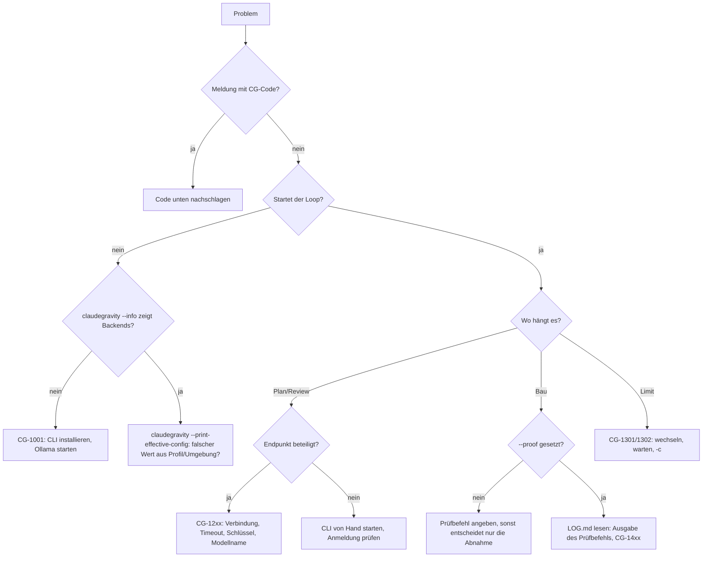

# Fehlerbehebung & bekannte Einschränkungen

[← Zurück zur Übersicht](../../README.md) · [Dokumentations-Index](README.md) · 🇬🇧 [English](../en/fehlerbehebung.md)

## Entscheidungsbaum

Ohne Mermaid-Ansicht: **Meldung mit CG-Code** → Code unten nachschlagen. **Loop startet nicht** → `claudegravity --info` (Backends da?) und `claudegravity --print-effective-config` (falscher Wert aus Profil oder Umgebung?). **Plan oder Review hängt** → bei Endpunkten Verbindung, Timeout, Schlüssel und Modellname prüfen (CG-12xx), bei CLIs die CLI einmal von Hand starten. **Bau kommt nicht ans Ziel** → `--proof` setzen und in `LOG.md` die Ausgabe des Prüfbefehls lesen (CG-14xx). **Limit** → wechseln, warten oder später mit `-c` weiter (CG-1301/1302).

## Häufige Probleme

| Symptom | Ursache | Lösung |
| :--- | :--- | :--- |
| `claudegravity: command not found` | Symlink fehlt oder `~/.local/bin` nicht im `PATH` | [Installation](installation.md) Schritt 2–3 prüfen; neue Shell öffnen. |
| `Python 3.10+ wurde nicht im System-PATH gefunden` (Windows) | Python fehlt oder nicht im `PATH` | Python von python.org installieren und „Add Python to PATH“ aktivieren. |
| Umlaute/Emojis kaputt (Windows) | Konsole nicht auf UTF-8 | `claudegravity.bat` bzw. `.ps1` statt `python loop.py` verwenden. |
| `Agent-CLI '…' ist nicht verfügbar` | Rolle auf ein nicht erkanntes Backend gesetzt | `claudegravity --info` prüfen, CLI installieren/anmelden. |
| Architekt und Prüfstatiker sind dasselbe Modell | Nur ein Backend installiert | Zweite CLI installieren oder einen Endpunkt als Prüfstatiker setzen. |
| Ollama / LM Studio wird nicht erkannt | Server lief beim Start nicht, oder anderer Port | Server zuerst starten; bei anderem Port `--bauer-endpoint http://localhost:<port>/v1 --bauer bauer_ep`. |
| `Verbindungsfehler zu …` | Endpunkt nicht erreichbar | URL im Browser/mit `curl` prüfen, VPN/Proxy prüfen. |
| `API-Fehler … HTTP 401` | Key fehlt oder falsch | `CLAUDEGRAVITY_API_KEY` setzen oder `--api-key` angeben. |
| „Modell versuchte eine Datei anzulegen“ | Architekt wollte trotz Planungsphase schreiben | Wird automatisch einmal wiederholt; bei Bedarf `--yolo` vermeiden. |
| Bau-Loop endet nach 10 Runden ohne `.done` | Rundenlimit erreicht | `claudegravity -c -m 20`. |
| Endpunkt-Bauleiter ändert keine Dateien | Antwort enthält keine `filepath:`-Blöcke | Größeres/besseres Modell wählen; Format siehe [Backends](backends.md#wie-endpunkt-bauleiter-dateien-schreiben). |
| Hängende Abfrage im Hintergrund (MCP `background: true`) | Interaktives Menü ohne Terminal | Lauf im Terminal starten oder `--yolo` nutzen und den Plan vorher prüfen. |

## Fehlercodes

Meldungen des Loops tragen einen Code `CG-xxxx` mit Lösungshinweis und Verweis auf diesen Abschnitt. Bereiche: 10xx Einrichtung, 11xx Konfiguration, 12xx Verbindung und Anbieter, 13xx Limits, 14xx Bau und Abnahme, 15xx Sicherheit. Mit `CLAUDEGRAVITY_DEBUG=1` erscheint bei unerwarteten Fehlern der vollständige Traceback.

**CG-1001 · Kein KI-Backend gefunden**  
Eine KI-CLI installieren und anmelden (z. B. `claude`, `codex`, `agy`), Ollama starten oder --endpoint <url> angeben. Prüfen mit `claudegravity --info`.

**CG-1002 · Gewählte CLI ist nicht verfügbar**  
Name mit `claudegravity --info` vergleichen (z. B. `ollama` ist der Ollama-Server) und die CLI installieren oder anmelden.

**CG-1003 · Projektordner existiert nicht**  
Pfad bei -p prüfen oder in den Projektordner wechseln.

**CG-1004 · Keine Sitzung zum Fortsetzen**  
Mit -p das richtige Projekt angeben oder eine neue Aufgabe starten.

**CG-1101 · Unbekannte Vorlage**  
Eingebaute Vorlagen: bugfix, feature, refactor. Eigene Vorlagen stehen im Profil unter `templates`.

**CG-1102 · Vorlage braucht einen Prüfbefehl**  
--proof "<testbefehl>" angeben oder `proof` ins Profil schreiben (`claudegravity init` hilft).

**CG-1103 · Budget-Angabe ungültig**  
Beispiele: --budget-max 500k (Tokens), --budget-max 2.50usd, --budget-roles "bauleiter=300k,abnahme=0.50usd".

**CG-1201 · Verbindung zum Endpunkt fehlgeschlagen**  
Läuft der Server (Ollama: `ollama serve`)? URL und Port mit `curl <url>/models` prüfen, VPN/Firewall prüfen.

**CG-1202 · Zeitüberschreitung beim Endpunkt**  
Mehr Zeit mit --timeout <sekunden> bzw. CLAUDEGRAVITY_TIMEOUT, ein kleineres Modell oder kleinere Etappen (--etappen an).

**CG-1203 · Anmeldung abgelehnt (HTTP 401/403)**  
CLAUDEGRAVITY_API_KEY setzen oder --api-key angeben; bei CLIs neu anmelden (z. B. `claude login`, `codex login`).

**CG-1204 · Modell oder Adresse nicht gefunden (HTTP 404)**  
Modellnamen mit `ollama list` bzw. `curl <url>/models` prüfen; die URL endet meist auf /v1.

**CG-1205 · Leere oder unlesbare Antwort**  
Anderes Modell wählen; sehr kleine Modelle halten das Antwortformat oft nicht ein.

**CG-1206 · KI-CLI meldet einen Fehler**  
Die CLI einmal von Hand im Terminal starten und ihre Meldung lesen; oft fehlt die Anmeldung oder ein Update.

**CG-1301 · Ratenlimit erreicht**  
Wechseln, warten oder Stand sichern; mit --auto-switch wechselt der Loop selbst. Fortsetzen mit `claudegravity -c`.

**CG-1302 · Anbieter antwortet auch nach Neuversuchen nicht**  
Später mit `claudegravity -c` fortsetzen oder den Anbieter wechseln; Zahl der Neuversuche mit --retries.

**CG-1401 · Rundenlimit ohne Fertigmeldung**  
Mit `claudegravity -c -m 20` weitere Runden anhängen; ein --proof hilft dem Bauleiter, das Ziel zu erkennen.

**CG-1402 · Abnahme-Limit erreicht, Befunde offen**  
Befunde in INSPECTION_round*.md lesen und mit `claudegravity -c` nacharbeiten lassen; mehr Runden mit --max-inspections.

**CG-1403 · Etappe nach drei Versuchen nicht grün**  
Ausgabe des Prüfbefehls in LOG.md lesen, Plan oder Etappe anpassen und mit `claudegravity -c` weitermachen.

**CG-1404 · Hartes Budget erreicht**  
Bericht mit Abbruchgrund steht in AUDIT.md. Weiter mit höherem Budget: `claudegravity -c --budget-max <wert>`, oder günstiger mit --strategy hybrid/eco bzw. weniger Runden (-m).

**CG-1501 · Schreibversuch blockiert**  
Ein Modell wollte außerhalb des Projekts oder in eine Geheimnis-Datei schreiben. Plan und Aufgabe prüfen.

**CG-1502 · Lesende Rolle hat Dateien geändert**  
Änderungen mit `git status` prüfen und bei Bedarf zurücknehmen; für diese CLI nur als Bauleiter einsetzen.

**CG-1503 · Mögliche Zugangsdaten in einer Modellantwort**  
Antwort prüfen; Zugangsdaten nur über Umgebungsvariablen nutzen und kompromittierte Schlüssel erneuern.

**CG-1999 · Unerwarteter Fehler**  
Bitte mit der vollständigen Ausgabe als Issue melden.

## Automatische Neuversuche

Vorübergehende Fehler wiederholt der Loop selbst, bevor er dich fragt: Überlastung (`overloaded`, `529`), HTTP 500/502/503/504/408, abgerissene oder verweigerte Verbindungen und bei Cloud-Anbietern auch Zeitüberschreitungen. Die Wartezeit verdoppelt sich mit jedem Versuch; die Hälfte davon ist zufällig (Jitter), damit parallele Läufe nicht gleichzeitig wiederkommen.

| Anbieter | Versuche | Wartezeit (ohne Jitter) |
| :--- | :--- | :--- |
| Lokal (Ollama, LM Studio, Heimnetz) | 3 | 2 s, 4 s, 8 s (höchstens 20 s) |
| Cloud (CLIs, öffentliche Endpunkte) | 3 | 5 s, 10 s, 20 s (höchstens 60 s) |

Eine Zeitüberschreitung bei einem lokalen Modell wird nicht wiederholt, denn ein zweiter Versuch rechnet genauso lange; dort hilft `--timeout`. Ein echtes Ratenlimit mit Reset-Zeit geht direkt ins Limit-Menü. Klappt auch der letzte Neuversuch nicht, erscheint dasselbe Menü (Wechseln, Warten, Beenden), mit `--auto-switch` wird sofort gewechselt. Jeder Neuversuch steht in `LOG.md`, die Summe im Audit-Block der `.done`. `--retries <n>` ändert die Zahl der Versuche, `--retries 0` schaltet sie ab.

## Abbrechen

`Strg+C` beendet die aktuelle Runde sauber, der Stand bleibt erhalten. Fortsetzen mit `claudegravity -c`.

## Bekannte Einschränkungen

Diese Punkte entsprechen dem aktuellen Stand des Codes:

* **Effort nur für Antigravity und Codex:** `--effort` und die rollenbezogenen Effort-Flags werden an `agy` und `codex` übergeben. Bei anderen CLIs erscheinen sie nur im Audit-Bericht.
* **Prüfer-Sitzung fortsetzen nur bei Claude:** Ab Review-Runde 2 bekommt nur ein Claude-Prüfer den Plan-Diff statt des ganzen Plans. Andere Prüfer bekommen den vollständigen Plan.
* **Copilot:** Wird über `copilot suggest -t shell` angesprochen und eignet sich damit eher für Shell-Vorschläge als für Planung oder Bau.
* **Kosten-Erkennung bei Endpunkten:** Als kostenlos gelten `localhost`, private IPs und Rechnernamen im Heimnetz (ohne Punkt oder mit `.local`, `.lan`, `.fritz.box`, `.home.arpa`, `.internal`). Ein Server im Intranet mit öffentlichem Domainnamen erscheint im Audit als „API“.
