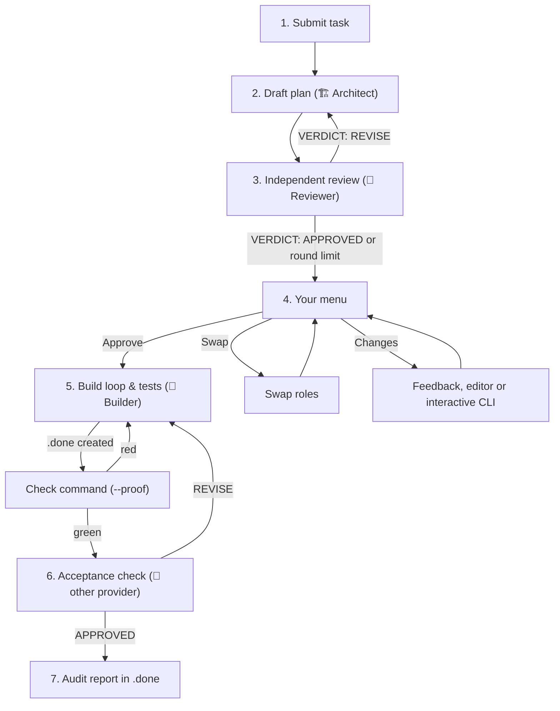

# Workflow & Roles

[← Back to overview](../../README.md) · [Documentation index](README.md) · 🇩🇪 [Deutsch](../de/ablauf-und-rollen.md)

## The principle

When a single model plans or builds and then grades its own work, it overlooks its own reasoning errors. ClaudeGravity therefore separates the roles – like on a construction site. The rule applies to every combination of providers (claude, agy, gemini, codex, local endpoints): **Whoever plans does not review the plan; whoever builds does not sign off the code.**

| Role | Phase | Task | Token share (rough guide) |
| :--- | :--- | :--- | :--- |
| **🏗️ Architect** (`--architekt` / `--planner`) | 1 – Planning | Drafts the plan as Markdown. Writes **no** files while doing so. | ~10–15 % |
| **🧐 Reviewer** (`--pruefstatiker` / `--reviewer`) | 2 – Review | A *different* model checks the plan for logic errors, race conditions, missing tests and security holes. | ~5–10 % |
| **🔨 Builder** (`--bauer` / `--builder`) | 3 – Build loop | Implements the approved plan in code and tests until the completion signal is in place. | ~80–90 % |
| **🔎 Acceptance check** (`--abnahme` / `--inspector`) | 4 – Acceptance | A *different* provider than the Builder checks the finished diff against the plan. Only then is the task considered done. | ~5 % |

Architect, Reviewer and Acceptance check **only read**, even with `--yolo`. Only the Builder gets write permissions (see [Backends](backends.md#permissions--yolo)).
Because the build loop consumes most of the tokens, it pays off to use a cheaper or local model there – see [Strategies](strategien.md).



## Default assignment

Without any options, ClaudeGravity picks:

* **Architect:** `claude` if installed, otherwise the first backend found.
* **Reviewer:** `agy` if installed, otherwise the next backend that is **not** the same CLI as the Architect. If there is only one backend, it reviews itself (which defeats the principle).
* **Builder:** Follows the Architect, unless `--bauer` is set or `--strategy local-free` selects a local backend.
* **Acceptance check:** `--abnahme <key>`, otherwise the Reviewer, otherwise the Architect, otherwise any other backend – but never the same backend with the same model as the Builder. If there is only one provider, ClaudeGravity reports that no independent acceptance check is possible and notes this in `LOG.md`.

With `--swap` the default roles are swapped: Antigravity (or Gemini) plans, Claude reviews.

## Phase 1 & 2: Plan and review

* The Architect receives the task, the project context (`CLAUDE.md`/`AGENTS.md`/`.claude/rules.md` and `knowledge/`, see [Sessions & files](sessions-und-dateien.md)) and the strict instruction to output only Markdown.
* If the model returns a permission error message instead of a plan, ClaudeGravity repeats the call with clearer instructions.
* The Reviewer answers with `BEFUNDE:` (findings; per finding `- [HOCH|MITTEL|NIEDRIG] Stelle: Problem -> Fix`, i.e. high/medium/low, location: problem -> fix), `EMPFEHLUNGEN:` (recommendations) and a separate last line `VERDICT: APPROVED|REVISE|BLOCKED`.
* Only this last `VERDICT` line counts. If a model repeats the template or writes "kein VERDICT: APPROVED" (no VERDICT: APPROVED), that is **not** an approval. If the verdict is missing, the plan is considered not approved.
* `APPROVED` with an open HOCH or MITTEL finding counts as `REVISE`. `REVISE` with only NIEDRIG findings counts as approval with notes (saves a round).
* On `REVISE`, the Architect receives only the list of findings, not the whole answer. It adopts justified findings, rejects unfounded ones with a reason and appends a `## Stellungnahme zu den Befunden` (response to the findings) section. New versions are called `PLAN_v2.md`, `PLAN_v3.md` …; older ones are never overwritten.
* If Claude is the Reviewer, from round 2 on the same reviewer session continues (`--resume`) and receives only the **diff** of the plan instead of the whole plan.
* After `--max-rounds` rounds (default 2) the automatic loop ends – even without approval – and you decide in the menu.
* The approval is bound to the content: `state.json` stores the SHA-256 of the approved plan. If the file is changed afterwards, the approval expires on resume and the review runs again.

### Question mode (`-i` / `--ask`)

If the task leaves room for interpretation, Architect and Reviewer may output a `### FRAGEN AN DEN NUTZER:` (questions for the user) section. ClaudeGravity shows the questions, you answer in the terminal (or skip with [Enter]), and the answer flows into the next plan version.

## The approval menu

| Key | Action |
| :--- | :--- |
| **[1] / [Enter]** | Approve the plan, continue to phase 3. |
| **[2] Changes** | Submenu (see below). |
| **[3] Swap** | Swap Architect and Reviewer (including model and effort). Applies to further change rounds in the menu; the menu then appears again. |
| **[4] Anzeigen** (show) | Print the plan in the terminal. |
| **[5] Beenden** (quit) | Abort. Resume later with `claudegravity -c`. |

**Changes** submenu:

| Key | Action |
| :--- | :--- |
| [1] | Open the plan in the editor (`$EDITOR`, otherwise `xdg-open`). Afterwards it is saved as `PLAN_vN_manual.md`. |
| [2] | Show the path for the Claude web/desktop UI, edit it there, then [Enter]. |
| [3] | Type feedback; the Architect produces a new plan version. |
| [4] | Start an interactive CLI session of the Architect in the project folder. |
| [5] | Start an interactive CLI session of the Reviewer. |
| [6] | Back to the main menu. |

## Phase 3 & 4: Build loop, check command and acceptance check

After approval, the Builder implements the plan over several rounds. When it creates `.done`, the task is not finished yet: ClaudeGravity runs the check command (`--proof`) itself and has the diff checked by the Acceptance check. How this works is described in [Build loop](bau-loop.md). How tests are planned, checked and run is described in [Tests](tests.md).

## Limits & auto-switch

If ClaudeGravity detects a rate or session limit in a CLI's output (e.g. "rate limit", "usage limit", "quota exceeded", "overloaded", HTTP 429), this appears:

```
[1] 🔄 Modell-Wechsel -> sofort mit der anderen KI weiterarbeiten
[2] ⏳ Warten         -> Countdown bis zum Reset, dann automatisch wiederholen
[3] 💾 Beenden        -> Stand sichern (Fortsetzen mit 'claudegravity -c')
```

(Meaning: [1] switch model – continue immediately with the other AI; [2] wait – countdown until the reset, then retry automatically; [3] quit – save the current state, resume with `claudegravity -c`.)

With `--auto-switch` ClaudeGravity switches to the alternative without asking (`claude` ↔ `agy`, otherwise the next other backend). A switch never lands on the provider of the counterpart role: the Reviewer never becomes the Architect's provider, the Builder never becomes the Acceptance check's provider. If there is no such alternative, only waiting or quitting remains. Every switch is recorded in `LOG.md`, the new assignment in `state.json`.
