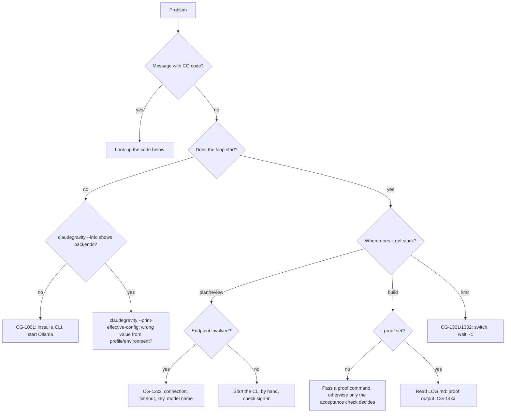

# Troubleshooting & known limitations

[← Back to overview](../../README.md) · [Documentation index](README.md) · 🇩🇪 [Deutsch](../de/fehlerbehebung.md)

## Decision tree

Without a Mermaid view: **message with a CG code** → look up the code below. **Loop does not start** → `claudegravity --info` (backends there?) and `claudegravity --print-effective-config` (wrong value from a profile or the environment?). **Plan or review stuck** → for endpoints check connection, timeout, key and model name (CG-12xx); for CLIs start the CLI once by hand. **Build does not reach the goal** → set `--proof` and read the proof output in `LOG.md` (CG-14xx). **Limit** → switch, wait or continue later with `-c` (CG-1301/1302).

## Common problems

| Symptom | Cause | Solution |
| :--- | :--- | :--- |
| `claudegravity: command not found` | Symlink missing or `~/.local/bin` not in `PATH` | Check [Installation](installation.md) steps 2–3; open a new shell. |
| `Python 3.10+ wurde nicht im System-PATH gefunden` (Windows) | Python missing or not in `PATH` | Install Python from python.org and enable "Add Python to PATH". |
| Broken umlauts/emojis (Windows) | Console not set to UTF-8 | Use `claudegravity.bat` or `.ps1` instead of `python loop.py`. |
| `Agent-CLI '…' ist nicht verfügbar` | Role assigned to an undetected backend | Check `claudegravity --info`, install/sign in to the CLI. |
| Architect and Reviewer are the same model | Only one backend installed | Install a second CLI or set an endpoint as Reviewer. |
| Ollama / LM Studio not detected | Server was not running at startup, or a different port | Start the server first; for a different port use `--bauer-endpoint http://localhost:<port>/v1 --bauer bauer_ep`. |
| `Verbindungsfehler zu …` | Endpoint unreachable | Check the URL in a browser/with `curl`, check VPN/proxy. |
| `API-Fehler … HTTP 401` | Key missing or wrong | Set `CLAUDEGRAVITY_API_KEY` or pass `--api-key`. |
| "Model tried to create a file" | Architect tried to write despite the planning phase | Automatically retried once; avoid `--yolo` if needed. |
| Build loop ends after 10 rounds without `.done` | Round limit reached | `claudegravity -c -m 20`. |
| Endpoint Builder doesn't change any files | Response contains no `filepath:` blocks | Choose a bigger/better model; for the format see [Backends](backends.md#how-endpoint-builders-write-files). |
| Hanging prompt in the background (MCP `background: true`) | Interactive menu without a terminal | Start the run in a terminal or use `--yolo` and review the plan beforehand. |

## Error codes

Loop messages carry a code `CG-xxxx` with a fix hint and a link to this section. Ranges: 10xx setup, 11xx configuration, 12xx connection and providers, 13xx limits, 14xx build and acceptance, 15xx security. With `CLAUDEGRAVITY_DEBUG=1` unexpected errors show the full traceback.

**CG-1001 · No AI backend found**  
Install and sign in to an AI CLI (e.g. `claude`, `codex`, `agy`), start Ollama or pass --endpoint <url>. Check with `claudegravity --info`.

**CG-1002 · Selected CLI is not available**  
Compare the name with `claudegravity --info` (e.g. `ollama` is the Ollama server) and install or sign in to the CLI.

**CG-1003 · Project folder does not exist**  
Check the path given with -p or change into the project folder.

**CG-1004 · No session to resume**  
Point -p at the right project or start a new task.

**CG-1101 · Unknown template**  
Built-in templates: bugfix, feature, refactor. Your own templates live in a profile under `templates`.

**CG-1102 · Template needs a proof command**  
Pass --proof "<test command>" or put `proof` in a profile (`claudegravity init` helps).

**CG-1103 · Invalid budget**  
Examples: --budget-max 500k (tokens), --budget-max 2.50usd, --budget-roles "bauleiter=300k,abnahme=0.50usd".

**CG-1201 · Connection to endpoint failed**  
Is the server running (Ollama: `ollama serve`)? Check URL and port with `curl <url>/models`, check VPN/firewall.

**CG-1202 · Endpoint timed out**  
More time with --timeout <seconds> or CLAUDEGRAVITY_TIMEOUT, a smaller model or smaller stages (--etappen an).

**CG-1203 · Authentication rejected (HTTP 401/403)**  
Set CLAUDEGRAVITY_API_KEY or pass --api-key; for CLIs sign in again (e.g. `claude login`, `codex login`).

**CG-1204 · Model or address not found (HTTP 404)**  
Check the model name with `ollama list` or `curl <url>/models`; the URL usually ends in /v1.

**CG-1205 · Empty or unreadable answer**  
Choose another model; very small models often do not keep the answer format.

**CG-1206 · AI CLI reports an error**  
Start the CLI once by hand in a terminal and read its message; often the sign-in or an update is missing.

**CG-1301 · Rate limit reached**  
Switch, wait or save the state; with --auto-switch the loop switches by itself. Resume with `claudegravity -c`.

**CG-1302 · Provider does not answer even after retries**  
Resume later with `claudegravity -c` or switch providers; number of retries via --retries.

**CG-1401 · Round limit without completion signal**  
Add rounds with `claudegravity -c -m 20`; a --proof helps the builder see the goal.

**CG-1402 · Acceptance limit reached, findings open**  
Read the findings in INSPECTION_round*.md and let the builder rework them with `claudegravity -c`; more rounds with --max-inspections.

**CG-1403 · Stage not green after three attempts**  
Read the proof output in LOG.md, adjust the plan or stage and continue with `claudegravity -c`.

**CG-1404 · Hard budget reached**  
The report with the abort reason is in AUDIT.md. Continue with a higher budget: `claudegravity -c --budget-max <value>`, or cheaper with --strategy hybrid/eco or fewer rounds (-m).

**CG-1501 · Write attempt blocked**  
A model tried to write outside the project or into a secret file. Check the plan and the task.

**CG-1502 · Read-only role changed files**  
Check the changes with `git status` and revert them if needed; use this CLI only as builder.

**CG-1503 · Possible credentials in a model answer**  
Check the answer; use credentials only via environment variables and rotate compromised keys.

**CG-1999 · Unexpected error**  
Please report it as an issue with the full output.

## Automatic retries

The loop retries transient errors itself before asking you: overload (`overloaded`, `529`), HTTP 500/502/503/504/408, dropped or refused connections and, for cloud providers, timeouts. The wait doubles with each attempt; half of it is random (jitter) so parallel runs do not come back at the same moment.

| Provider | Attempts | Wait (without jitter) |
| :--- | :--- | :--- |
| Local (Ollama, LM Studio, home network) | 3 | 2 s, 4 s, 8 s (at most 20 s) |
| Cloud (CLIs, public endpoints) | 3 | 5 s, 10 s, 20 s (at most 60 s) |

A timeout on a local model is not retried, because a second attempt takes just as long; use `--timeout` there. A real rate limit with a reset time goes straight to the limit menu. If the last retry fails too, the same menu appears (switch, wait, quit); with `--auto-switch` the loop switches right away. Every retry is written to `LOG.md`, the total to the audit block in `.done`. `--retries <n>` changes the number of attempts, `--retries 0` turns them off.

## Cancelling

`Ctrl+C` cleanly ends the current round; the state is preserved. Resume with `claudegravity -c`.

## Known limitations

These points reflect the current state of the code:

* **Effort only for Antigravity and Codex:** `--effort` and the role-specific effort flags are passed to `agy` and `codex`. For other CLIs they only appear in the audit report.
* **Resuming the reviewer session only with Claude:** From review round 2 on, only a Claude reviewer receives the plan diff instead of the whole plan. Other reviewers receive the full plan.
* **Copilot:** Is called via `copilot suggest -t shell` and is therefore better suited to shell suggestions than to planning or building.
* **Cost detection for endpoints:** `localhost`, private IPs and hostnames on the home network (without a dot or ending in `.local`, `.lan`, `.fritz.box`, `.home.arpa`, `.internal`) count as free. An intranet server with a public domain name appears in the audit as "API".
